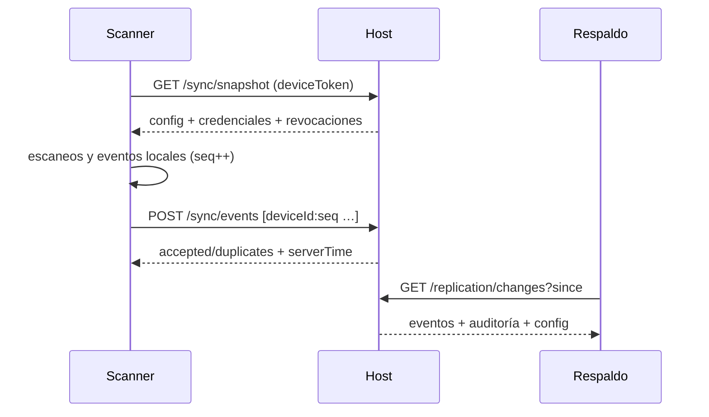

# Protocolo de sync y cómo añadir un tipo de evento

Fuentes: `docs/30-ARQUITECTURA.md` §2, §3 y §6; ADR-0004 (`docs/95-ADR/0004-sync-append-only.md`); ADR-0007 (nube). Código: `packages/core/src/event-log.ts`, `packages/core/src/device-events.ts`, `apps/host/src/routes/sync.ts`, `apps/host/src/repos.ts` (`ScanEventRepo`, `AlertRepo`), `apps/host/src/replication.ts`, `apps/scanner/src/sync.ts`, `apps/scanner/src/device-events.ts`.

## El protocolo en 8 líneas

1. **Snapshot** `GET /sync/snapshot` (scanner con `deviceToken`): `config`, `credentials` sin PII ni token, `revocations`, `serverTime`. El scanner lo guarda en Dexie y lo refresca por polling (15 s, backoff exponencial).
2. **Subida** `POST /sync/events { events: ScanEvent[], pending }`: cada evento `id = deviceId:seq`, `seq` monotónico por dispositivo. El host **ignora repetidos** (`appendBatch`), solo acepta eventos del propio `deviceId` del token, actualiza `lastSeq`/pendientes del dispositivo y genera alertas (`AlertRepo.fromScans`).
3. **Bajada** `GET /sync/events?since=<cursor>`: eventos por `receivedAt` (cursor del host, no reloj del scanner).
4. **LWW**: `config` por `configVersion`; revocaciones por `at`. Nunca hay conflicto en escaneos: son hechos.
5. **Eventos de dispositivo** (`manual_entry`, `exception`, `zone_change`, `mode_change`, `shift_start`, `shift_end`) viajan por el **mismo** `POST /sync/events`. Los que no son escaneos llevan `decision: 'EVENT'`, `credentialId: null`, `reasonCode` del mapa `DEVICE_EVENT_REASON` y el detalle tipado en `manual` (`ManualMeta`), único campo JSON libre que el host persiste (`manual_json`). `manual.reason` y `manual.by` siempre existen para que el host actual los muestre como texto.
6. **Replicación** primario → respaldo: `GET /replication/snapshot` y `GET /replication/changes?since&auditSeq&configVersion` con `TP_REPLICA_KEY`; el respaldo aplica con `applyReplication` (mismo log, misma idempotencia) y responde 409 a toda escritura.
7. **Nube → host**: `POST /sync/cloud/pull` consume `GET /api/export?since=` (clave `x-tatami-key`), idempotente por `external_id`.
8. **Reconciliación** (`reconcile(local, remote)` en core) es determinista: mismo par de entradas, mismo resultado.

## Añadir un tipo de evento de dispositivo (de extremo a extremo)

Atajo: `npx tsx scripts/agent/new-event-type.ts <snake_case> "<Descripción humana>"` hace los pasos 1–3 y crea el test; después sigue con 4–8 a mano.

1. **core · tipos** (`packages/core/src/device-events.ts`): añade el literal a `DeviceEventType`, su `reasonCode` en `DEVICE_EVENT_REASON` (MAYÚSCULAS), la variante en `ManualMeta` (siempre con `reason` y `by`; añade `authorizedBy` si lo autoriza un supervisor), el caso en `describeDeviceEvent` (texto humano del catálogo `docs/70`) y, si no es escaneo, inclúyelo en el `Extract<…>` de `buildDeviceEvent`.
2. **core · test** (`packages/core/test/device-events.test.ts` o el que genere el script): construye el evento con `buildDeviceEvent`, verifica `id === deviceId:seq`, `decision === 'EVENT'`, `reasonCode`, `describeDeviceEvent` y que `appendEvents` lo acepte una vez y lo cuente como duplicado la segunda.
3. **core · build**: `npm run build -w packages/core` (las apps importan `dist`).
4. **host**: no hace falta ruta nueva. Revisa `apps/host/src/reports.ts` y `repos.ts` (`gateSummary`, `deniedToday`, `liveSnapshot`) para que **ignoren** `decision === 'EVENT'` donde corresponda y, si el evento debe generar alerta o aparecer en Puertas en vivo, añádelo en `AlertRepo.fromScans` / `liveSnapshot`. Test en `apps/host/test/sync.test.ts`: sube el evento por `POST /sync/events`, comprueba `accepted: 1`, que `GET /sync/events` lo devuelve, que el resumen no lo cuenta como entrada y que `standby.test.ts` lo replica.
5. **scanner**: en `apps/scanner/src/device-events.ts` añade la función que lo construye y encola (`enqueueDeviceEvent`), dispáralo desde la pantalla o `lib/` que corresponda y, si tiene texto visible, añádelo al catálogo. Test en `apps/scanner/test/device-events.test.ts`.
6. **panel** (`apps/host-admin`): si debe verse (Alertas, Puertas en vivo, ficha de dispositivo), añade el caso con su etiqueta humana en `src/pages/*.tsx`.
7. **docs**: `docs/30-ARQUITECTURA.md` §6 (tabla de eventos), `docs/70-UX-WRITING.md` si hay texto, `docs/80-COMO-PROBAR.md` §3 ("Eventos nuevos en el log de sync"), `docs/99-CHANGELOG.md`. Si cambia la forma de `ScanEvent` (no solo `manual`), es un cambio de protocolo: ADR nuevo y compatibilidad con scanners viejos.
8. **e2e**: si el evento nace de un flujo de usuario, spec en `e2e/` nombrada por su TC; comprueba el evento en el host (`GET /sync/events`) con el texto exacto.

## Lo que no se hace

- Un endpoint nuevo por tipo de evento (rompe la idempotencia única y la replicación).
- `UPDATE`/`DELETE` sobre `scan_events`: corregir = evento compensatorio.
- Reutilizar `seq` o generarlo en el host: lo genera el dispositivo, monotónico, persistido en Dexie antes de enviar.
- Meter PII en `manual`: nombre del operador (`by`) sí; documento o fecha de nacimiento no.
- Depender del reloj del scanner para ordenar en el host: usa `receivedAt`.
