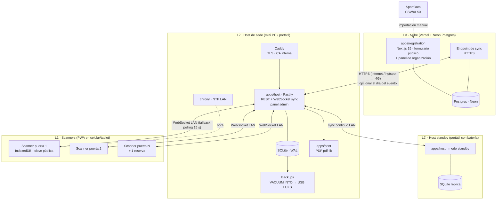
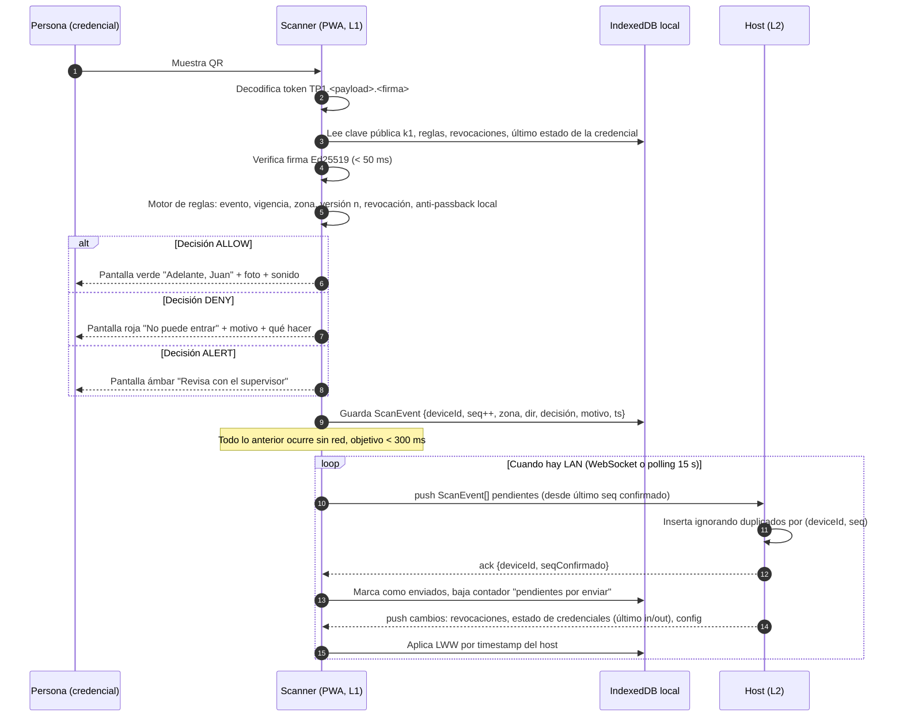
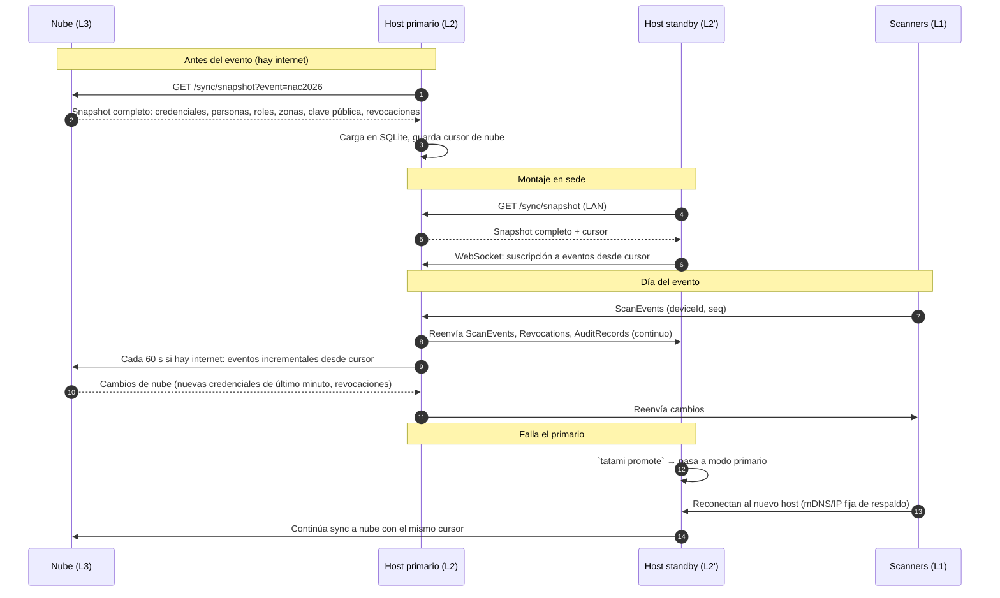
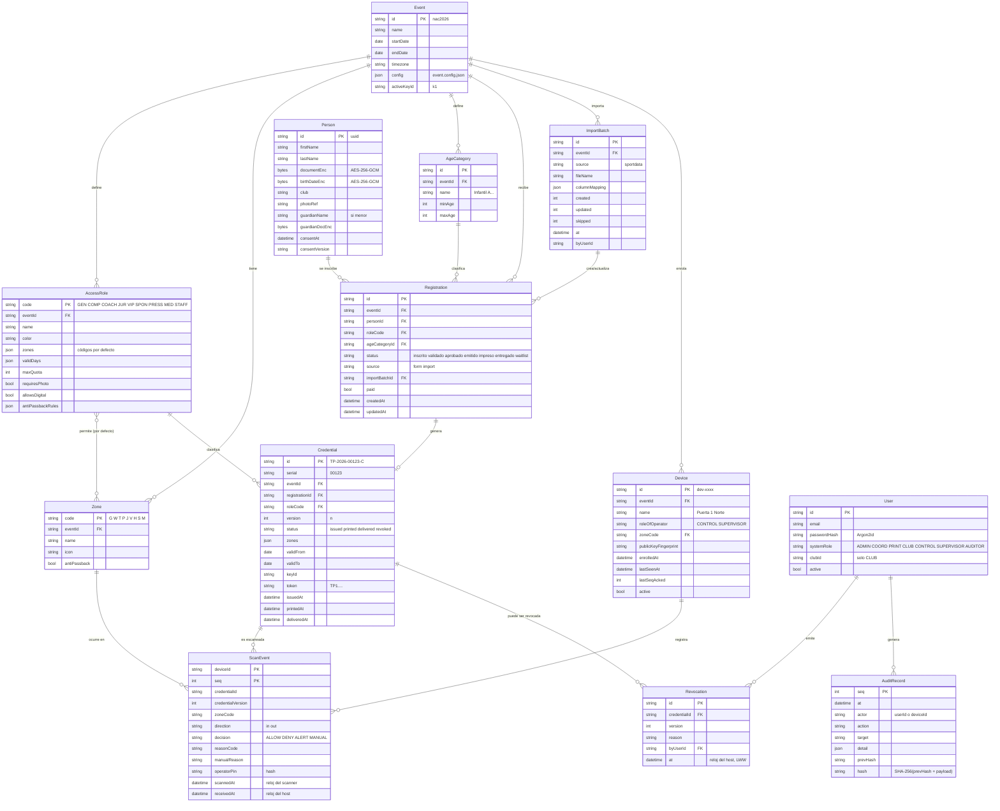

# 30 · Arquitectura técnica — Tatami Pass

> Coherente con `00-DECISIONES.md` v1.0. Si algo aquí contradice ese documento, manda `00`.
> Audiencia: equipo de desarrollo y quien instale el host. Documento técnico.

## 1. Vista general

Tatami Pass se organiza en tres niveles que funcionan de forma independiente. Cada nivel inferior sigue operando cuando el superior no está disponible.



### 1.1 Responsabilidades por nivel

| Nivel | Fuente de verdad de | Puede fallar sin afectar a |
|---|---|---|
| L1 Scanner | Nada (es réplica). Guarda hechos locales (`ScanEvent`) hasta subirlos. | Nadie; cada scanner es autónomo. |
| L2 Host | Todo lo que ocurre en la sede: escaneos, revocaciones del día, entregas, anti-passback, auditoría. | L1 (siguen validando sin host). |
| L3 Nube | Inscripciones, aprobaciones, importación SportData, emisión previa al evento. | L1 y L2 (el día del evento la nube es opcional). |

### 1.2 Paquetes del monorepo

```
tatami-pass/
├─ packages/core        dominio puro (sin IO): tipos, firma/verificación Ed25519,
│                       motor de reglas, log de eventos, categorías de edad, parser SportData
├─ apps/host            Fastify + better-sqlite3 (WAL) + Drizzle; sirve panel admin
├─ apps/scanner         PWA Vite + React + Dexie; BarcodeDetector → fallback @zxing/browser
├─ apps/registration    Next.js 15 App Router en Vercel; Postgres Neon
├─ apps/print           PDF de credenciales (pdf-lib), se ejecuta dentro del host
└─ scripts/simulate.ts  carga: 2.000 credenciales, 8 puertas, pico, corte de energía
```

`packages/core` es la única fuente de la lógica de decisión. El host, el scanner y la nube ejecutan **el mismo código** de verificación y reglas, por eso una decisión tomada offline en el scanner es idéntica a la que tomaría el host.

## 2. Escaneo offline y su sincronización



Puntos clave:

- El scanner **nunca espera al host** para decidir. La red solo mejora la información (anti-passback entre puertas, revocaciones recientes, alertas de duplicado).
- El anti-passback **local** del scanner cubre su propia puerta; el anti-passback **entre puertas** lo resuelve el host y llega al scanner como "estado de credencial" en el siguiente ciclo de sync.
- La alerta de duplicado (mismo QR en dos puertas en menos de 2 min) la calcula el host y la envía a los scanners y al panel del supervisor.

## 3. Sincronización host ↔ nube ↔ standby



El standby es **un cliente de sync más** con la base completa. No hay lógica especial de replicación: usa el mismo protocolo que un scanner, pero suscribiéndose a todas las tablas.

## 4. Modelo de datos



### 4.1 Notas sobre el modelo

- **Credential.id** es el ID público corto: `TP-2026-` + serial de 5 dígitos + `-` + dígito verificador Luhn mod 36. Se imprime grande para fallback manual.
- **ScanEvent** tiene clave primaria compuesta `(deviceId, seq)`. Es la base de la idempotencia. `seq` es un entero monotónico por dispositivo que nunca se reutiliza, ni siquiera tras reinstalar la PWA (se guarda en IndexedDB y, al enrolar de nuevo, el host entrega el último `seq` conocido).
- **ScanEvent** y **AuditRecord** son **append-only**: no hay `UPDATE` ni `DELETE`. Una corrección se expresa como un nuevo evento.
- **Revocation** y los cambios de `Credential.status` son LWW con reloj del host.
- Campos sensibles (`documentEnc`, `birthDateEnc`, `guardianDocEnc`) se cifran con AES-256-GCM y una clave derivada por evento (HKDF de la clave maestra + `eventId`). El scanner **no recibe** estos campos; recibe nombre, foto, rol, zonas, vigencia y versión.
- La edad para categorías se calcula en la nube al inscribirse y se guarda el resultado (`ageCategoryId`); el scanner no necesita la fecha de nacimiento.

## 5. Formato del token QR

### 5.1 Token estático (credencial física)

```
TP1.<payload base64url>.<firma base64url>
```

| Parte | Contenido |
|---|---|
| `TP1` | Prefijo y versión de formato. Un scanner que no reconozca el prefijo rechaza con `FORMAT_UNKNOWN`. |
| payload | JSON compacto (sin espacios, claves en orden fijo) codificado en base64url sin padding. |
| firma | Ed25519 sobre los bytes `"TP1." + payload_base64url`. 64 bytes → 86 caracteres base64url. |

Payload exacto (claves en este orden, siempre):

```json
{"v":1,"e":"nac2026","c":"00123","r":"COMP","z":["A","W","T"],"f":"2026-11-20","t":"2026-11-22","n":3,"k":"k1"}
```

| Clave | Significado |
|---|---|
| `v` | Versión del esquema de payload (1). |
| `e` | ID del evento. |
| `c` | Serial de la credencial (5 dígitos). El ID corto se reconstruye como `TP-2026-<c>-<Luhn>`. |
| `r` | Código del rol de acceso. |
| `z` | Zonas permitidas. Nota: aquí viajan los códigos de zona configurados; en el ejemplo de `00-DECISIONES.md` aparece `"A"` como ejemplo de código adicional. |
| `f` / `t` | Primer y último día válido (ISO 8601, fecha local del evento). |
| `n` | Versión de la credencial. Si el scanner conoce una versión mayor para `c`, rechaza con `SUPERSEDED`. |
| `k` | ID de la clave de firma. El scanner tiene las claves públicas por ID; si no conoce `k`, rechaza con `KEY_UNKNOWN`. |

Tamaño típico: ~110 bytes de payload + 86 de firma + 5 de prefijo ≈ 215 caracteres → QR versión 10–11 con corrección M, legible a 40 mm.

Orden de verificación en el scanner (se detiene en el primer fallo):

1. Prefijo `TP1` y tres partes.
2. Decodificar payload; `v === 1`; `e` coincide con el evento del dispositivo.
3. `k` conocida → verificar firma Ed25519.
4. `n` ≥ última versión conocida de `c` (si no, `SUPERSEDED`).
5. `c` no está en la lista de revocación (`REVOKED`).
6. Fecha de hoy entre `f` y `t` (`OUT_OF_DATES`).
7. Zona del dispositivo ∈ `z` (`ZONE_NOT_ALLOWED`).
8. Reglas de rol (`AccessRole`): días válidos, restricciones (`ROLE_RULE`).
9. Anti-passback: último evento conocido para `c` en esta zona es `in` sin `out` (`ALREADY_INSIDE`).
10. Si hay estado "sospechoso" (duplicado en otra puerta < 2 min) → `ALERT_DUPLICATE`.

### 5.2 QR rotativo (credencial digital, solo rol GEN)

```
TP1R.<payload base64url>.<firma base64url>
```

Payload:

```json
{"v":1,"e":"nac2026","c":"01542","r":"GEN","z":["G"],"f":"2026-11-20","t":"2026-11-20","n":1,"k":"k1","iat":1763640000,"exp":1763640060}
```

- `iat`/`exp` en segundos Unix. Ventana de validez: **60 s**. El scanner acepta `exp` hasta **+5 min** de deriva (según `00 §8`).
- La firma de cada QR rotativo la genera la **nube** (la clave privada no sale de ahí). La página de la credencial digital pide tokens nuevos al servidor; si no hay internet en el celular del público, muestra el último token válido y una cuenta regresiva. Cuando expira sin red, muestra el ID corto y el aviso "Acércate a la taquilla".
- Un pantallazo caduca en ≤ 60 s. Un QR rotativo reenviado por chat caduca igual.
- Los roles acreditados **no** usan QR rotativo: su credencial es física.

## 6. Protocolo de sync

Mismo protocolo para scanner↔host, host↔nube y host↔standby. Transporte: WebSocket (`/sync/ws`) con fallback a polling HTTP (`/sync/pull`, `/sync/push`) cada 15 s.

### 6.1 Snapshot inicial

```
GET /sync/snapshot?event=nac2026&scope=scanner|full
Authorization: Bearer <token del dispositivo o del host>
```

Respuesta: archivo JSON Lines comprimido (gzip) con todas las filas de las tablas del `scope` y un `cursor` (`{ hostSeq: 48213, at: "..." }`). Para `scope=scanner`: `Credential` (sin tokens, solo `id`, `version`, `status`, `roleCode`, `zones`, `validFrom/To`, nombre, foto miniatura), `AccessRole`, `Zone`, `Revocation`, claves públicas, estado in/out de credenciales. Para `scope=full`: todas las tablas.

Tamaño estimado para 2.000 credenciales con fotos miniatura (JPEG 96×128, ~6 KB): ~14 MB. En LAN se descarga en segundos; se hace una vez por dispositivo y luego solo incrementales.

### 6.2 Eventos incrementales

Cada mensaje de sync es un sobre:

```json
{
  "type": "ScanEvent | Revocation | CredentialState | ConfigChange | AuditRecord",
  "origin": "dev-a1b2 | host-primary | cloud",
  "seq": 1234,
  "at": "2026-11-20T09:14:03.120-05:00",
  "payload": { }
}
```

- **Push** (cliente → servidor): el cliente envía todos los sobres con `seq` > `lastSeqAcked`. El servidor responde `{ "ack": { "origin": "dev-a1b2", "seq": 1240 } }`.
- **Pull** (servidor → cliente): el cliente envía su `cursor.hostSeq`; el servidor responde con todos los sobres de su log con `hostSeq` mayor.
- Lotes de hasta 500 sobres; el cliente repite hasta quedar al día.

### 6.3 Idempotencia

- Clave de deduplicación: `(origin, seq)`. El servidor hace `INSERT ... ON CONFLICT DO NOTHING`. Reenviar un lote completo es seguro.
- `seq` es monotónico por origen y persistente. Un reinicio del scanner no reinicia `seq`.
- El ack es acumulativo: ack de `seq=1240` confirma todo lo anterior.

### 6.4 Resolución de conflictos

| Tipo | Regla | Por qué |
|---|---|---|
| `ScanEvent` | No hay conflicto: son hechos. Todos se guardan. | Append-only. |
| `Revocation` | LWW por `at` del host (quien recibe). Si dos revocaciones de la misma credencial llegan, gana la última; ambas quedan en el log. | Revocar es irreversible en la práctica; la "des-revocación" se hace re-emitiendo (`n+1`). |
| `CredentialState` (dentro/fuera por zona) | Lo calcula **solo el host** a partir de los `ScanEvent` ordenados por `scannedAt`; los scanners lo reciben, no lo emiten. | Evita que dos scanners discutan. |
| `ConfigChange` | LWW por `at` del host. | Cambios de cupos, zonas, roles. |
| `Credential` nueva desde nube | Se inserta; si existe con `version` menor, se actualiza y se genera `Revocation` automática de la versión anterior. | Re-emisión. |

### 6.5 Reconciliación tras desconexión larga

1. Al reconectar, el scanner envía su `lastSeqAcked` y su `cursor.hostSeq`.
2. Hace push de pendientes en lotes de 500.
3. Hace pull de todo lo que le falta (revocaciones, estados, config).
4. Si el host responde que el `cursor` es más antiguo que su retención de log (no debería pasar en un evento de 3 días), el scanner pide un snapshot nuevo de `scope=scanner`.
5. Objetivo medible (00 §11): 5.000 eventos en < 30 s.

Si el host cambió (promoción del standby), el scanner recibe `hostId` distinto en el handshake; como el standby tiene el mismo log con los mismos `hostSeq`, el cursor sigue siendo válido. Si el standby se quedó atrás respecto al primario caído (ventana de pocos segundos), los scanners reenvían lo pendiente y el standby lo acepta por idempotencia; lo único que puede perderse son revocaciones manuales hechas en el primario en esos segundos, que el coordinador repite.

## 7. Enrolamiento de dispositivos

```mermaid
sequenceDiagram
  participant SUP as Supervisor (panel host)
  participant H as Host
  participant D as Dispositivo nuevo
  SUP->>H: "Enrolar dispositivo" → nombre, rol operador, zona
  H->>H: Genera token único (32 bytes aleatorios), caduca en 10 min, un solo uso
  H-->>SUP: QR de enrolamiento en pantalla
  D->>D: Instala certificado raíz (guía 1 vez por dispositivo)
  D->>H: Abre https://host.tatamipass.local/enroll?t=<token>
  H->>H: Valida token, lo consume, crea Device {id, rol, zona}
  H-->>D: deviceId, token de dispositivo (larga duración, atado al deviceId), claves públicas, cursor
  D->>D: Guarda en IndexedDB, pide PIN de 6 dígitos al operador
  D->>H: GET /sync/snapshot?scope=scanner
  Note over D: Listo. La sesión del operador caduca a las 12 h; el enrolamiento no.
```

- El QR de enrolamiento contiene: URL con token + huella SHA-256 del certificado raíz (para verificar que se instaló el correcto).
- El token de dispositivo se envía en cada mensaje de sync. Si el supervisor desactiva el dispositivo (`Device.active=false`), el host rechaza su sync pero el dispositivo sigue validando offline hasta que el operador cierra sesión; por eso un scanner perdido se gestiona **también** rotando la lista de revocación y, si hace falta, la clave (ver `40 §6`).
- El PIN se guarda como hash (Argon2id) en el dispositivo; tres intentos fallidos bloquean 5 min.

## 8. HTTPS en LAN

Las PWA requieren contexto seguro para `getUserMedia` (cámara). Dos opciones aceptadas en `00 §8`.

### 8.1 Opción principal: Caddy con CA interna

`Caddyfile` del host:

```caddyfile
{
  local_certs
  pki {
    ca tatami {
      name "Tatami Pass CA"
    }
  }
}

host.tatamipass.local, 10.10.0.2 {
  tls internal
  reverse_proxy app:3000
  encode gzip
  header Strict-Transport-Security "max-age=31536000"
}
```

- Caddy genera la CA raíz en el primer arranque y la guarda en el volumen `caddy_data`. **Esa misma CA se copia al standby** para que los dispositivos confíen en ambos hosts.
- El host anuncia `host.tatamipass.local` por mDNS (avahi) y, además, tiene IP fija `10.10.0.2` (standby `10.10.0.3`) como respaldo si mDNS falla en algún teléfono.
- La raíz se exporta con `docker compose exec caddy cat /data/caddy/pki/authorities/tatami/root.crt` y se sirve en `http://10.10.0.2/ca.crt` (sin TLS, solo para instalar) junto con la guía.
- Instalación en dispositivos (1 vez): Android → Ajustes › Seguridad › Instalar certificado de CA; iOS → descargar perfil, instalar, y luego Ajustes › General › Información › Ajustes de confianza de certificados › activar. La guía con capturas está en `60 §6`.

### 8.2 Alternativa: Let's Encrypt DNS-01

Si no se quiere instalar certificados en cada dispositivo:

1. Se usa el dominio real `host.tatamipass.co` con registro A → `10.10.0.2` (una IP privada en DNS público es válido).
2. Antes del evento, con internet, se emite el certificado por DNS-01 (Caddy con el módulo del proveedor DNS, o `certbot` + `lego`). Válido 90 días.
3. Los dispositivos resuelven `host.tatamipass.co` solo si tienen DNS. Como la LAN no tiene internet, el router debe tener un **DNS local** (dnsmasq en el host) que responda `host.tatamipass.co → 10.10.0.2`; el router entrega el host como DNS por DHCP.
4. Ventaja: cero configuración en los teléfonos. Desventaja: dependencia de haber renovado el certificado a tiempo y de que el DNS local funcione.

Decisión: la opción 8.1 es la predeterminada porque no depende de nada externo; la 8.2 se documenta como alternativa aceptada.

## 9. Despliegue

### 9.1 Host (Docker Compose)

```yaml
# docker-compose.yml (host)
services:
  caddy:
    image: caddy:2.8-alpine
    ports: ["80:80", "443:443"]
    volumes:
      - ./Caddyfile:/etc/caddy/Caddyfile:ro
      - caddy_data:/data
      - caddy_config:/config
    restart: unless-stopped

  app:
    image: ghcr.io/tatami-pass/host:1.0.0
    user: "10001:10001"            # sin root
    environment:
      TP_EVENT_ID: nac2026
      TP_MODE: primary             # primary | standby
      TP_DB_PATH: /data/tatami.db
      TP_SIGNING_KEY_FILE: /secrets/signing-k1.enc
      TP_SIGNING_KEY_PASSPHRASE_FILE: /run/secrets/signing_passphrase
      TP_FIELD_KEY_FILE: /run/secrets/field_key
      TP_CLOUD_URL: https://app.tatamipass.co
      TP_CLOUD_TOKEN_FILE: /run/secrets/cloud_token
      TP_BACKUP_DIR: /backup
      TP_BACKUP_INTERVAL_MIN: "5"
      TP_LOG_LEVEL: info
    volumes:
      - ./data:/data
      - ./secrets:/secrets:ro
      - /mnt/usb-backup:/backup
    secrets: [signing_passphrase, field_key, cloud_token]
    restart: unless-stopped
    healthcheck:
      test: ["CMD", "wget", "-qO-", "http://localhost:3000/health"]
      interval: 15s
      timeout: 3s
      retries: 3

  chrony:
    image: cturra/ntp:latest
    cap_add: [SYS_TIME]
    ports: ["123:123/udp"]
    restart: unless-stopped

secrets:
  signing_passphrase: { file: ./secrets/signing_passphrase }
  field_key:          { file: ./secrets/field_key }
  cloud_token:        { file: ./secrets/cloud_token }

volumes:
  caddy_data:
  caddy_config:
```

Alternativa sin Docker: `node dist/server.js` con las mismas variables de entorno y Caddy instalado como servicio del sistema.

### 9.2 Nube (Vercel + Neon)

- `apps/registration` se despliega en Vercel desde la rama `main`; previews por PR.
- Base: Neon Postgres (rama `main` para producción, ramas efímeras para previews).
- Variables: `DATABASE_URL`, `TP_SIGNING_KEY_ENC` (clave privada cifrada, base64), `TP_SIGNING_KEY_PASSPHRASE`, `TP_FIELD_KEY`, `TP_SYNC_HOST_TOKENS` (tokens de hosts autorizados), `NEXTAUTH_SECRET`.
- La firma de credenciales y de QR rotativos se hace en Route Handlers de Node (no Edge) para usar `crypto` nativo.
- Endpoints de sync: `/api/sync/snapshot`, `/api/sync/push`, `/api/sync/pull`. Protegidos por token de host (Bearer) y limitados por IP.

### 9.3 Scanner

Se sirve desde el host (`https://host.tatamipass.local/scanner`). Al instalarse como PWA, el service worker cachea todo el shell; después funciona sin ninguna red. Se actualiza solo cuando hay LAN y el host tiene una versión nueva (el operador ve "Hay una versión nueva, toca para actualizar").

## 10. Observabilidad

### 10.1 Logs

- Formato JSON por línea (pino). Campos fijos: `ts`, `level`, `component`, `eventId`, `deviceId|userId`, `msg`.
- Nunca se loguean: tokens, PIN, documento, fecha de nacimiento, passphrases.
- Rotación: 7 días en host, por tamaño 50 MB. Se incluyen en el backup.
- En el scanner: buffer en memoria de los últimos 200 eventos + errores en IndexedDB; se suben al host como `DeviceLog` en el sync (baja prioridad).

### 10.2 Métricas de puerta

Expuestas en `/metrics` (formato Prometheus) y mostradas en el panel admin:

| Métrica | Uso |
|---|---|
| `tp_scans_total{zone,decision,reason}` | Volumen y tasa de rechazo por puerta y motivo. |
| `tp_scan_latency_ms` (histograma, reportado por scanners) | Verificar objetivo < 300 ms. |
| `tp_device_pending_events{device}` | "Pendientes por enviar"; si crece, hay problema de red en esa puerta. |
| `tp_device_last_seen_seconds{device}` | Dispositivo caído o fuera de cobertura (> 60 s alerta). |
| `tp_inside_now{zone}` | Personas dentro de cada zona (por anti-passback). |
| `tp_alerts_total{type}` | Duplicados, revocadas escaneadas, manuales. |
| `tp_sync_cloud_lag_seconds` | Retraso con la nube (informativo). |
| `tp_backup_last_success_seconds` | Si > 600, alerta en panel. |
| `tp_standby_lag_events` | Eventos que el standby aún no tiene; > 100 alerta. |

### 10.3 Health

- `GET /health` → `{ ok, mode, dbWritable, diskFreeMb, backupAgeSec, standbyLag, cloudReachable, ntpSynced }`. Lo usa Docker, el panel y el runbook.
- El panel admin muestra un semáforo por dispositivo y por subsistema (DB, backup, standby, nube, NTP).

## 11. Decisiones y trade-offs

| Decisión | Alternativa descartada | Por qué |
|---|---|---|
| **SQLite (WAL) en el host** | Postgres en el host | Un solo archivo = backup trivial (`VACUUM INTO`), cero administración, arranca en un portátil cualquiera, miles de escrituras/s de sobra para 25 personas/min. Postgres añade un servicio más que puede fallar y un backup más complejo. En la nube sí se usa Postgres porque allí hay concurrencia real y lo administra Neon. |
| **Token firmado en el QR** | URL a un servidor | Una URL exige red para validar; el principio rector es que funcione sin nada. El token firmado se verifica con la clave pública en 50 ms sin tocar la red. Además, una URL se puede abrir en cualquier navegador y confunde a la gente. |
| **PWA** | App nativa Android/iOS | Sin tiendas, sin revisiones, se instala desde el host en 30 s, misma base de código, actualización instantánea en LAN. `BarcodeDetector` es nativo en Android/Chrome; en iOS el fallback `@zxing/browser` cumple el objetivo de 300 ms. El costo es HTTPS obligatorio en LAN (resuelto con Caddy). |
| **Append-only** para escaneos y auditoría | Tablas mutables con estado actual | Sin conflictos de sync (un hecho no se discute), idempotencia trivial, auditoría verificable con hash encadenado, reconstruir "quién está dentro" es un `GROUP BY`. El costo es más filas; 2.000 personas × 3 días × ~10 eventos = 60.000 filas, irrelevante. |
| **Ed25519** | HMAC compartido / RSA | Con HMAC cualquier scanner podría firmar credenciales. Con Ed25519 los scanners solo verifican; firmas de 64 bytes caben en un QR de 40 mm. RSA daría firmas de 256+ bytes. |
| **Host como fuente de verdad de la sede** | Nube como fuente de verdad | Internet en coliseos es inestable. La nube es útil antes (inscripción) y después (reportes); el día D es opcional por diseño. |
| **Standby como cliente de sync** | Replicación nativa de BD (Litestream, rqlite) | Reutiliza el protocolo ya probado; un solo mecanismo que entender y operar. Litestream se evaluó y queda como mejora posible para v2 si se necesita RPO de milisegundos. |
| **Caddy CA interna por defecto** | Let's Encrypt DNS-01 | No depende de internet, DNS ni fechas de renovación. El costo es instalar un certificado en cada teléfono, una sola vez, con guía. |
| **PIN de 6 dígitos en scanner** | Usuario/contraseña en scanner | El operador cambia de turno con guantes y prisa; el dispositivo ya está enrolado y atado a una puerta, así que el PIN identifica a la persona del turno sin fricción. |
