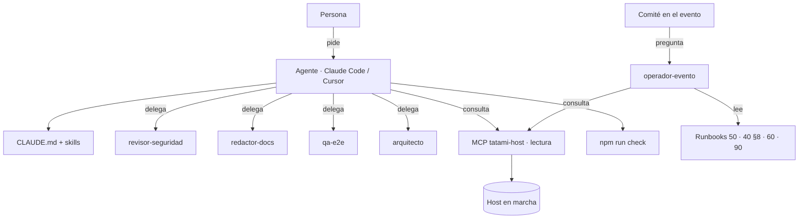

# 36 · Trabajar con agentes — Tatami Pass

> Para desarrolladores que usan Claude Code, Cursor u otro agente de código sobre este repo, y para el comité que quiera un asistente durante el simulacro y el día D. Qué hay, cómo se usa, qué flujos están probados y, sobre todo, **qué no puede hacer un agente**. Complementa a [`CLAUDE.md`](../CLAUDE.md) (raíz) y [`AGENTS.md`](../AGENTS.md).

## 1. Qué hay en el repo

| Pieza | Dónde | Para qué |
|---|---|---|
| Guía raíz | [`CLAUDE.md`](../CLAUDE.md) · [`AGENTS.md`](../AGENTS.md) | Mapa del monorepo, comandos, invariantes, convenciones, qué verificar antes de terminar. Claude Code la carga sola; otros agentes leen `AGENTS.md`. |
| Guías por workspace | `packages/core/CLAUDE.md`, `apps/host/CLAUDE.md`, `apps/scanner/CLAUDE.md`, `apps/registration/CLAUDE.md` | Lo específico de cada parte: estructura, reglas propias, cómo verificar. |
| Permisos y hooks | `.claude/settings.json`, `.claude/hooks/` | Permite `npm test/build/typecheck/e2e/docs` sin preguntar; pide confirmación para `git commit/push/tag`, `npm install`, `docker`, `release.ts`; **niega** leer `keys/`, `.env`, bases `.db`, y correr `purge`, `restore`, `promote`, `rm -rf`, `push --force`. Hook `PostToolUse`: tras editar un `.ts/.tsx` de `apps/*` o `packages/*` corre el typecheck de ese workspace y muestra los errores. Hook `PreToolUse`: si el comando es `git commit`, corre `npm test` y bloquea el commit si falla. |
| Subagentes | `.claude/agents/` | `revisor-seguridad` (STRIDE + docs/40), `redactor-docs` (docs y UX writing), `qa-e2e` (tests y specs por TC), `operador-evento` (runbooks, solo lectura), `arquitecto` (ADRs). Se invocan por nombre ("usa el subagente revisor-seguridad") o los llaman los comandos. |
| Slash commands | `.claude/commands/` | `/nuevo-rol`, `/nuevo-escenario-demo`, `/preparar-release`, `/simulacro`, `/revisar-pr`, `/adr`. Cada uno es un procedimiento con pasos y verificaciones. |
| Skills | `.claude/skills/*/SKILL.md` | `tatami-ux-writing` (voz, glosario, catálogo), `tatami-evento-config` (roles, cupos, zonas con validación), `tatami-operacion-dia-d` (runbook accionable), `tatami-sync-protocolo` (añadir un tipo de evento de extremo a extremo). El agente las carga cuando la tarea coincide con su descripción. |
| Herramientas ejecutables | `scripts/agent/` | `check-all.sh` (test + build + typecheck + `docs:gen` sin diff + enlaces; `npm run check`), `new-event-type.ts` (scaffold de evento de sync con test), `verify-docs-links.ts` (`npm run docs:links`), `release.ts` (changelog + versiones + etiqueta). |
| Servidor MCP | `.mcp.json` → `scripts/mcp/host-server.ts` | Herramientas sobre el host en marcha: `health`, `gate_summary`, `cloud_status`, `search_credential` (lectura) y `revoke_credential` (escritura con doble candado). |
| Generadores de docs | `scripts/docs/gen-api.ts`, `gen-config.ts` | `npm run docs:gen` → `docs/31-API-REFERENCIA.md`, `docs/32-CONFIG-EVENTO.md`. |



## 2. Puesta en marcha

1. Claude Code en la raíz del repo: carga `CLAUDE.md`, `.claude/settings.json`, agentes, comandos y skills automáticamente. Cursor y otros leen `AGENTS.md`.
2. MCP del host (opcional): levanta un host (`npm run seed && npm run dev:host`) y Claude Code arrancará `tatami-host` desde `.mcp.json` (`npx tsx scripts/mcp/host-server.ts`). Variables: `TP_HOST_URL` (por defecto `http://127.0.0.1:8787`), `TP_HOST_USER`/`TP_HOST_PASSWORD` (por defecto `audit`/`audit123`: **solo lectura por RBAC**), `TP_HOST_INSECURE=1` si el host está detrás de Caddy con CA interna, `TP_MCP_ALLOW_WRITE=1` solo si de verdad quieres permitir `revoke_credential`.
3. Verificación de que todo está bien cableado: `npm run check` termina con "Todo en verde".

Probado en este repo (Node 22): `check-all.sh`, `new-event-type.ts` (scaffold + test + typecheck en verde sobre un tipo de prueba), `verify-docs-links.ts`, `release.ts --dry-run`, y el servidor MCP contra un host con seed (lista de 5 herramientas, `health`, `search_credential` sin PII, `gate_summary`, `cloud_status`, y `revoke_credential` rechazado sin `TP_MCP_ALLOW_WRITE`).

## 3. Flujos

### 3.1 Añadir un rol de acceso

```
/nuevo-rol VOL "Voluntario" zonas=G,H cupo=40 foto=si digital=no color=#C8F560
```

Qué hace el agente (skill `tatami-evento-config`): edita `apps/host/event.config.json` (y `default-config.ts` si el rol es permanente), valida con `validateEventConfig`, ajusta seed y PDF de muestra si aplica, comprueba el nombre en el catálogo de `docs/70`, actualiza `docs/00` §5, `docs/10` §5, `docs/50` §1.4 (lanyard) y `docs/99`, corre `npm run docs:gen` y `npm test`. Tú revisas el diff y, si el evento ya está en marcha, aplicas el cambio por el panel › Evento y roles (no editando el archivo del host en caliente).

### 3.2 Atender un incidente con `operador-evento`

Durante el simulacro o el día D, el Técnico o el Coordinador pregunta en Claude Code:

> "La puerta T1 lleva 6 minutos sin conexión y tiene 23 pendientes. ¿Qué hago?"

El subagente lee `docs/50` §11 y `docs/90` §10, consulta `health` y `gate_summary` por el MCP (si está) y responde: qué está pasando, pasos numerados con la ruta del panel o el comando y **quién** lo hace, cómo saber que quedó bien y qué registrar (alerta resuelta con nota; `docs/_plantillas/runbook-incidente.md`). Si la respuesta implica promover el respaldo, anular una credencial o restaurar una copia, el agente lo **indica**, no lo ejecuta.

### 3.3 Preparar una release

```
/preparar-release 0.3.0 --dry-run
```

El agente exige `git status` limpio, corre `npm run check` y la suite e2e, completa `[Sin publicar]` en `docs/99-CHANGELOG.md` comparando con `git log`, y ejecuta `scripts/agent/release.ts 0.3.0` (sin `--commit` deja los archivos para revisar; con `--commit` crea el commit `chore(release): v0.3.0` y la etiqueta; el `git push --follow-tags` siempre es manual). Marca los criterios de `docs/20` §8.

### 3.4 Revisar un PR

```
/revisar-pr --staged
```

Recorre el checklist de `.github/PULL_REQUEST_TEMPLATE.md` con evidencia, delega en `revisor-seguridad` si el diff toca `auth`, `pii`, `qr-token`, `field-crypto`, `sync`, `replication` o `cloud-sync`, y en `redactor-docs` si hay texto visible; corre `npm run check` y la spec afectada.

### 3.5 Añadir un tipo de evento de sync

```
npx tsx scripts/agent/new-event-type.ts battery_low "Batería baja" --campos level:number
```

Hace los pasos de core (tipo, `reasonCode`, `ManualMeta`, `describeDeviceEvent`, `buildDeviceEvent`, test) y lista lo que falta en host, scanner, panel, docs y e2e (skill `tatami-sync-protocolo`).

### 3.6 Escribir un ADR

```
/adr "Litestream para replicar el host al respaldo"
```

El subagente `arquitecto` crea `docs/95-ADR/NNNN-….md` desde la plantilla con contexto, decisión, alternativas, consecuencias y referencias, y lo deja en estado Propuesto.

## 4. Límites: lo que un agente no hace

1. **No toma decisiones de acceso en la puerta.** Quién entra lo decide el scanner con reglas firmadas y, en los casos ámbar o manuales, el Supervisor de puerta con su PIN. Un agente puede explicar el procedimiento; nunca "autorizar", ni por MCP ni por API.
2. **No ejecuta acciones irreversibles de operación**: promover el respaldo, restaurar una copia, purgar datos, desactivar scanners o usuarios. `settings.json` niega `purge`, `restore` y `promote`; el MCP no expone esas rutas. Las indica y nombra a quién le toca (`docs/60`).
3. **Anular una credencial por MCP** requiere dos candados: `TP_MCP_ALLOW_WRITE=1` al arrancar el servidor y `confirm: "ANULAR <id>"` escrito por la persona que autoriza. Queda en la auditoría con el usuario del MCP. Por defecto está apagado.
4. **No ve datos personales**: el usuario del MCP por defecto es `audit` (solo lectura); `search_credential` responde ID, nombre, rol, estado, zonas y versión, nunca documento ni fecha de nacimiento. `settings.json` niega leer `keys/`, `.env` y bases `.db`.
5. **No cambia invariantes sin ADR**: firma Ed25519, offline-first, append-only, UX writing humano, Ley 1581, RBAC. Si una tarea las toca, el agente debe parar y pedir `/adr`.
6. **No hace `git commit` ni `push`** sin que se lo pidan; y si lo piden, el hook corre `npm test` antes y bloquea en rojo.
7. **No inventa que algo se probó.** Si no corrió un comando, lo dice. Los documentos generados (`docs/31`, `docs/32`) no se editan a mano.
8. **No sustituye el simulacro ni al Supervisor.** Un agente ayuda a preparar el checklist y a rellenar el acta; la decisión go/no-go la firman personas (`docs/20` §7.5).

## 5. Mantener esto

- Un comando, skill o subagente nuevo se documenta en la tabla de §1 y, si cambia un flujo, en §3.
- Las skills citan documentos por número de sección: si mueves una sección, actualiza la skill (`npm run docs:links` detecta enlaces rotos, no citas en texto).
- Cuando el otro agente de la sesión paralela deje listo `npm run e2e:smoke`, `check-all.sh --e2e` y `CLAUDE.md` ya lo usan; hasta entonces, `E2E_SKIP_REGISTRATION=1 npm run e2e` es el equivalente.
