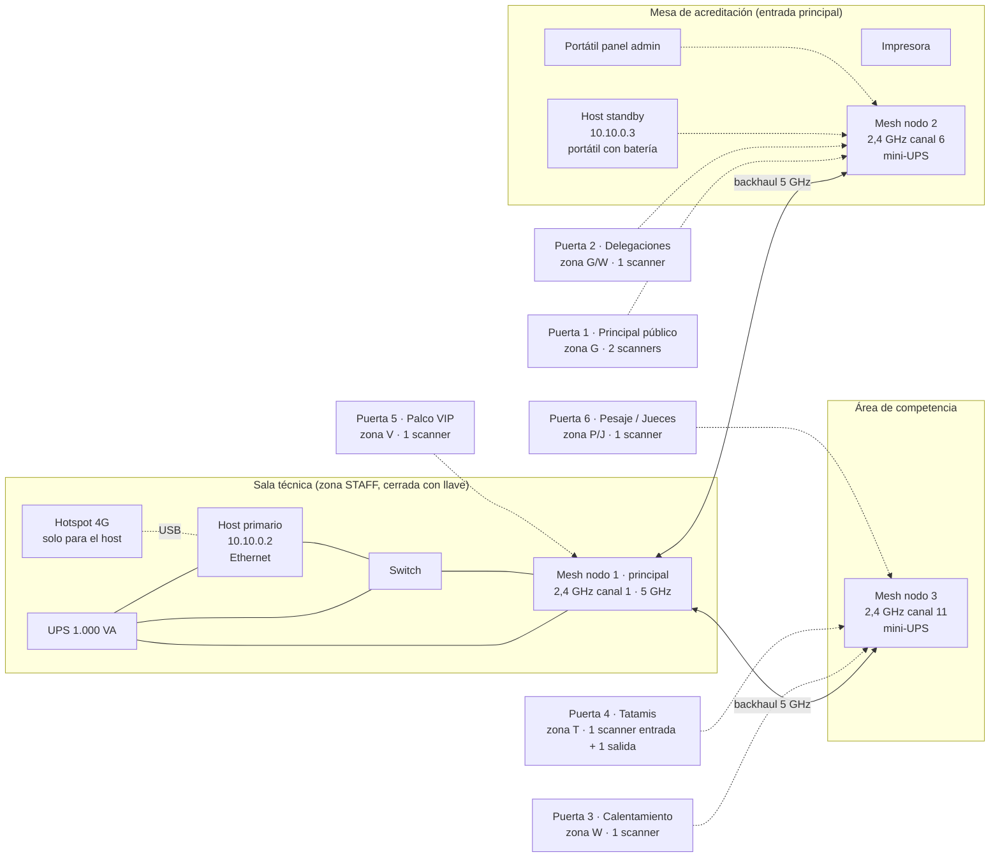

# 50 · Runbook de operaciones — Tatami Pass

> Coherente con `00-DECISIONES.md` v1.0 §8, §9, §11. Audiencia: Administrador del evento, técnico de sede, Coordinador. Mezcla instrucciones técnicas (host, red) con procedimientos operativos.

## 1. Lista de compras y equipo

Dimensionado para un coliseo de **~2.000 personas**, **6 puertas activas** (hasta 8), 3 días de evento.

### 1.1 Cómputo

| Ítem | Cant. | Referencia | Notas |
|---|---|---|---|
| **Host primario** | 1 | Mini PC: Intel NUC / Beelink / Minisforum con CPU de 4+ núcleos, 16 GB RAM, SSD NVMe 256 GB+, Ethernet. Alternativa: portátil con las mismas specs (ventaja: batería integrada). | Ubuntu 24.04 con LUKS. Nunca el portátil personal de alguien. |
| **Host standby** | 1 | Portátil con batería (≥ 4 h), 8 GB RAM, SSD 128 GB+. | Se ubica en otro punto físico (p. ej. mesa de acreditación) conectado al mesh. |
| **Portátil de panel/admin** | 1 | Cualquier portátil con navegador. | Para que el Coordinador use el panel sin tocar el host. |
| **Scanners** | 6 + 2 reserva | Android 11+ con Chrome 100+ (BarcodeDetector nativo) o iPhone con iOS 16+. Pantalla ≥ 6". Cámara con enfoque automático. Referencia: Samsung A-series, Motorola G-series, iPhone SE/11+. | Mejor dispositivos del comité, no personales. Fundas con agarre de mano. |
| **Impresora de credenciales** | 1 (+1 de respaldo) | Opción A (recomendada): **láser color A4** (Brother HL-L3270CDW / HP Color LaserJet M255) + papel cartulina 200 g o **PVC imprimible láser** cortado a 100 × 150 mm (o A4 con 4 credenciales por hoja y cortadora/guillotina). Opción B: **impresora de tarjetas** (Evolis Primacy / Zebra ZC300) con tarjetas CR80; menor tamaño que 100 × 150, requiere adaptar diseño. | La láser imprime 500 credenciales en < 30 min y los insumos son baratos y fáciles de conseguir en Popayán/Cali. |
| **Guillotina** | 1 | Guillotina de palanca A4. | Para cortar las credenciales. |
| **Radios físicas** (respaldo) | 4 (supervisores + técnico + acreditación) | Walkie-talkie UHF/PMR con auricular. | La comunicación principal es **Tatami Radio** dentro del scanner y el panel (§12, docs/34); las radios físicas quedan para cuando falle la Wi-Fi de staff. |
| **Plastificadora** (opcional) | 1 | A4 térmica + fundas 100 × 150 (125 micras). | Protege el QR y evita manipulación. |

### 1.2 Red

| Ítem | Cant. | Referencia | Notas |
|---|---|---|---|
| **Router / mesh principal** | 1 kit de 3 | **TP-Link Deco X50 (Wi-Fi 6, 3 unidades)** o Deco M5. Alternativa pro: Ubiquiti UniFi (1 Dream Router + 2 U6 Lite, requiere más configuración). | Mesh real (backhaul dedicado) cubre un coliseo típico de 60 × 40 m con 3 nodos. |
| **Nodos mesh adicionales** | 1–2 | Deco X50 unidades sueltas. | Si hay puertas en el exterior o pisos distintos. Total 4–5 nodos para ~2.000 personas en coliseo grande. |
| **Switch** | 1 | 5 puertos Gigabit (TP-Link TL-SG105). | Host + router + standby si está al alcance de cable. |
| **Cables Ethernet** | 3–4 | Cat 6, 3 m y 10 m. | Host siempre por cable. |
| **Hotspot 4G** | 1 | Celular con datos o módem 4G USB. | Solo para que el host hable con la nube; **no** se comparte con la red de staff. |

### 1.3 Energía

| Ítem | Cant. | Referencia | Notas |
|---|---|---|---|
| **UPS 1.000 VA** | 1 | APC Back-UPS BX1000 / Forza NT-1011 (1.000 VA / 600 W). | Alimenta host, router principal y switch. Autonomía estimada ≥ 45 min con ~80 W de carga. |
| **Mini-UPS 12 V** | 2–4 | Mini UPS para router (p. ej. "mini UPS 10400 mAh 12 V/9 V") | Uno por nodo mesh lejos del UPS principal. 2–4 h. |
| **Power banks** | 8 | 20.000 mAh, con 2 salidas USB. | Uno por scanner. Consumo estimado del scanner: 10 %/h; un power bank recarga el teléfono 3–4 veces. |
| **Cargadores y cables** | 8 | USB-C y Lightning según los teléfonos. | |
| **Regleta con protección** | 2 | 6 tomas con supresor de picos. | |

### 1.4 Credenciales e insumos

| Ítem | Cant. | Notas |
|---|---|---|
| **Papel/PVC 100 × 150 mm** | 2.500 | 2.000 + 25 % para re-emisiones y pruebas. |
| **Lanyards por color de rol** | Según cupos + 10 % | Colores sugeridos (coherentes con `event.config.json`): GEN gris, COMP azul, COACH verde, JUR negro, VIP dorado, SPON naranja, PRESS morado, MED blanco con cruz, STAFF rojo. |
| **Portacredencial 100 × 150** | Igual a lanyards | Vertical, transparente. |
| **Hologramas adhesivos** | 1.000 | Hologramas genéricos numerados de 10 × 10 mm; se pegan sobre el ID corto de las credenciales de roles acreditados (no GEN). |
| **Cinta de seguridad / precintos** | 1 rollo | Para sellar sobres de modo degradado y la caja del host. |
| **Tóner** | 1 juego de respaldo | Un juego CMYK adicional. |
| **Tablillas con planilla manual** | 8 | Una por puerta (modo degradado). |
| **Bolígrafos, marcadores** | — | |
| **USB cifradas** | 2 | USB 3.0 de 64 GB, formateadas con LUKS (ver §7). Una en el host, otra se rota cada 2 h y se guarda en la mesa de acreditación. |
| **Etiquetas** | — | Para marcar scanners ("P1-NORTE"), power banks y nodos mesh. |

## 2. Plano de red tipo



### 2.1 Reglas de ubicación

- **Host y nodo principal**: en la sala técnica, a la altura de 1,5–2 m, lejos de paredes de concreto gruesas y de equipos de sonido.
- **Nodo 2**: en la mesa de acreditación (suele estar junto a la puerta principal). El standby se conecta a este nodo por cable si es posible (los Deco tienen puertos Ethernet).
- **Nodo 3**: en el área de competencia, en altura (mesa de jurado o estructura), cubriendo puertas de calentamiento, tatamis y pesaje.
- Distancia máxima nodo–scanner recomendada: **25 m con línea de vista**, 12 m con una pared.
- Canales 2,4 GHz: 1 / 6 / 11, uno por nodo (los mesh lo hacen solos; si son repetidores clásicos, fijarlos a mano).
- Si alguna puerta está en el exterior o detrás de graderías de concreto, añadir un nodo.

### 2.2 Cómo medir cobertura antes del evento (T-1)

1. Instala en un scanner la app **WiFiman** (Ubiquiti, gratuita) o **WiFi Analyzer** (Android).
2. Conecta el scanner a la red de staff.
3. Párate exactamente donde estará cada portero y anota el RSSI:
   - **≥ −65 dBm**: excelente.
   - **−65 a −70 dBm**: bien.
   - **−70 a −75 dBm**: funciona pero reubica el nodo más cercano o añade uno.
   - **< −75 dBm**: no aceptable.
4. Abre la PWA del scanner y verifica que el indicador de conexión está en verde y que "pendientes por enviar" baja a 0 tras un escaneo de prueba.
5. Repite con la gradería llena de gente simulada no es posible, así que deja **margen**: la gente absorbe señal. Si en vacío estás en −70, el día D estarás en −75.
6. Anota los valores en el acta de T-1.

## 3. Instalación del host paso a paso

Requisitos: Ubuntu 24.04 LTS instalado con **cifrado de disco (LUKS)** marcado en el instalador. Usuario administrador `ops`.

```bash
# 0. Hardening base (ver 40 §7.1): ufw, SSH por llave, unattended-upgrades, chrony.

# 1. Docker
sudo apt update && sudo apt install -y ca-certificates curl git
sudo install -m 0755 -d /etc/apt/keyrings
curl -fsSL https://download.docker.com/linux/ubuntu/gpg | sudo gpg --dearmor -o /etc/apt/keyrings/docker.gpg
echo "deb [arch=$(dpkg --print-architecture) signed-by=/etc/apt/keyrings/docker.gpg] https://download.docker.com/linux/ubuntu $(. /etc/os-release && echo $VERSION_CODENAME) stable" | sudo tee /etc/apt/sources.list.d/docker.list > /dev/null
sudo apt update && sudo apt install -y docker-ce docker-ce-cli containerd.io docker-compose-plugin
sudo usermod -aG docker ops && newgrp docker

# 2. IP fija en la LAN de staff (netplan)
sudo tee /etc/netplan/01-tatami.yaml > /dev/null <<'EOF'
network:
  version: 2
  ethernets:
    enp0s31f6:            # cambia por tu interfaz (ip link)
      dhcp4: no
      addresses: [10.10.0.2/24]
      routes: []          # SIN ruta por defecto: esta red no sale a internet
      nameservers:
        addresses: [10.10.0.2]
EOF
sudo netplan apply

# 3. Carpeta del host
sudo mkdir -p /opt/tatami && sudo chown ops:ops /opt/tatami && cd /opt/tatami
git clone https://github.com/tatami-pass/deploy.git .      # contiene docker-compose.yml, Caddyfile, tatami CLI
mkdir -p data secrets && chmod 700 secrets

# 4. Secretos
tatami keys generate --event nac2026 --id k1          # pide passphrase; crea secrets/signing-k1.enc y .pub
openssl rand -hex 32 > secrets/field_key
openssl rand -hex 32 > secrets/cloud_token             # el mismo valor se registra en la nube (panel admin › Hosts)
printf '%s' 'LA_PASSPHRASE' > secrets/signing_passphrase
chmod 600 secrets/*

# 5. Configuración del evento
cp event.config.example.json data/event.config.json
nano data/event.config.json                            # ver §5

# 6. Arranque
docker compose up -d
docker compose logs -f app                             # espera "listening on :3000" y "mode=primary"
curl -sk https://10.10.0.2/health | jq                 # ok:true, dbWritable:true

# 7. Cargar snapshot desde la nube (requiere hotspot conectado al host)
tatami cloud pull --event nac2026                      # descarga credenciales, personas, roles, zonas
tatami audit verify                                    # cadena OK

# 8. Exportar la CA para los dispositivos
docker compose exec caddy cat /data/caddy/pki/authorities/tatami/root.crt > data/public/ca.crt
# queda disponible en http://10.10.0.2/ca.crt

# 9. Backup a USB (ver §7) y verificación
tatami backup now && tatami backup verify --latest

# 10. mDNS (opcional, para host.tatamipass.local)
sudo apt install -y avahi-daemon && sudo hostnamectl set-hostname host && sudo sed -i 's/^#\?domain-name=.*/domain-name=tatamipass.local/' /etc/avahi/avahi-daemon.conf && sudo systemctl restart avahi-daemon
```

### 3.1 Instalación del standby

En el portátil standby, mismos pasos 0–3, con estas diferencias:

```bash
# IP fija 10.10.0.3 (netplan igual que arriba, cambia la dirección)
# Secretos: NO copies signing-k1.enc ni signing_passphrase. Sí copia field_key y cloud_token.
scp ops@10.10.0.2:/opt/tatami/secrets/{field_key,cloud_token} secrets/
# Copia la CA de Caddy para que los scanners confíen en ambos hosts
scp -r ops@10.10.0.2:/opt/tatami/caddy_data ./caddy_data   # o docker cp del volumen
# Modo
sed -i 's/TP_MODE: primary/TP_MODE: standby/' docker-compose.yml
echo "TP_PRIMARY_URL=https://10.10.0.2" >> .env
docker compose up -d
tatami standby status      # muestra lag en eventos; debe llegar a 0 en < 1 min
```

### 3.2 Cómo promover el standby

Cuando el primario cae y no vuelve en 2 minutos:

```bash
# En el standby:
tatami promote
# → detiene la suscripción al primario, cambia TP_MODE a primary, reinicia app,
#   anuncia host.tatamipass.local por mDNS y empieza a aceptar scanners.
tatami status              # mode=primary, devices connected: N
```

Los scanners tienen configuradas **ambas** direcciones (`10.10.0.2` y `10.10.0.3`); al perder al primario prueban el standby cada 15 s y reconectan solos. No hay que tocar los teléfonos.

Cuando el primario vuelva: **no lo enciendas como primario**. Enciéndelo como standby del nuevo primario (`TP_MODE=standby`, `TP_PRIMARY_URL=https://10.10.0.3`) y deja así hasta el final del evento. Las claves de firma: si hace falta emitir en sede, carga `signing-k1.enc` desde la USB del Administrador al nuevo primario.

## 4. Registro de dispositivos (resumen)

Detalle en `30 §7` y guía para el portero en `60 §6`. Resumen para el técnico:

1. Panel admin › Dispositivos › **Enrolar** → nombre (`P4-TATAMI-IN`), rol del operador (Control / Supervisor), zona (T), dirección (entrada / salida).
2. Muestra el QR al teléfono. El teléfono debe tener ya instalado `ca.crt`.
3. El teléfono abre la URL, confirma, pide PIN al operador, descarga el snapshot (~14 MB, < 30 s en LAN).
4. En el panel, el dispositivo aparece en verde. Pégale la etiqueta con el nombre.

## 5. Configuración del evento: `event.config.json`

> **Nota (2026-10-14):** el ejemplo de abajo es la versión de diseño original. El esquema **real** que lee el host (campos `capacity`, `days`, `antiPassbackZones`, `companions`, `totalCapacity`, `configVersion`…) está documentado campo por campo, con valores por defecto y reglas de validación, en [32-CONFIG-EVENTO.md](./32-CONFIG-EVENTO.md) (generado desde `packages/core`). Usa ese documento para editar; este apartado se conserva por los procedimientos de §5.1 y §5.2.

Vive en `data/event.config.json` del host y en la nube (panel › Evento › Configuración). Cambiarlo en cualquiera de los dos genera un `ConfigChange` que se sincroniza (LWW). Durante el evento, **solo el Administrador** lo cambia y queda en auditoría.

```jsonc
{
  "id": "nac2026",                        // ID del evento. Va en el payload del QR (e). No cambiar después de emitir.
  "name": "Campeonato Nacional de Taekwondo ITF 2026",
  "timezone": "America/Bogota",
  "dates": { "from": "2026-11-20", "to": "2026-11-22" },   // Primer y último día. La edad se calcula a "from".
  "idPrefix": "TP-2026-",                 // Prefijo de los IDs cortos.
  "activeKeyId": "k1",                    // Clave de firma vigente. Cambia a k2 si rotas.
  "globalQuota": 2000,                    // Cupo total de credenciales emitidas (todos los roles).

  "zones": [                              // Zonas físicas. "code" va en el QR (z). "icon" es el pictograma impreso.
    { "code": "G", "name": "Gradería",             "icon": "seat",    "antiPassback": false },
    { "code": "W", "name": "Área de calentamiento", "icon": "warmup",  "antiPassback": true },
    { "code": "T", "name": "Tatamis",              "icon": "tatami",  "antiPassback": true },
    { "code": "P", "name": "Pesaje",               "icon": "scale",   "antiPassback": false },
    { "code": "J", "name": "Sala de jueces",       "icon": "gavel",   "antiPassback": true },
    { "code": "V", "name": "Palco",                "icon": "star",    "antiPassback": true },
    { "code": "H", "name": "Hospitalidad",         "icon": "cup",     "antiPassback": false },
    { "code": "S", "name": "Stands",               "icon": "booth",   "antiPassback": false },
    { "code": "M", "name": "Zona de prensa",       "icon": "camera",  "antiPassback": false }
  ],

  "roles": [                              // Roles de acceso (tipos de entrada). Ver 00 §5.
    {
      "code": "GEN",                      // Va en el QR (r). Máx. 6 caracteres, mayúsculas.
      "name": "General",
      "color": "#9CA3AF",                 // Fondo/franja de la credencial y color del lanyard.
      "zones": ["G"],                     // Zonas por defecto. El Coordinador puede ajustar por persona.
      "validDays": "perDay",              // "all" = todo el evento; "perDay" = se elige el día al inscribirse.
      "maxQuota": 1200,                   // Cupo del rol. Al llegar, el formulario ofrece lista de espera.
      "requiresPhoto": false,
      "allowsDigital": true,              // Único rol con credencial digital (QR rotativo).
      "antiPassback": { "G": false }      // Puede sobreescribir el de la zona.
    },
    {
      "code": "COMP", "name": "Competidor", "color": "#1C4FD1",
      "zones": ["G", "W", "T", "P"], "validDays": "all", "maxQuota": 600,
      "requiresPhoto": true, "allowsDigital": false,
      "ageCheck": true,                   // Exige categoría de edad coherente.
      "source": "sportdata"               // Informativo: se importa de SportData.
    },
    {
      "code": "COACH", "name": "Coach", "color": "#16A34A",
      "zones": ["G", "W", "T"], "validDays": "all", "maxQuota": 150,
      "requiresPhoto": true, "allowsDigital": false,
      "maxPerClub": 3                     // Máximo por club.
    },
    { "code": "JUR",   "name": "Jurado",       "color": "#0F172A", "zones": ["G","W","T","J"], "validDays": "all", "maxQuota": 60,  "requiresPhoto": true,  "allowsDigital": false },
    { "code": "VIP",   "name": "VIP",          "color": "#D4A017", "zones": ["G","V","H"],     "validDays": "all", "maxQuota": 50,  "requiresPhoto": true,  "allowsDigital": false },
    { "code": "SPON",  "name": "Patrocinador", "color": "#F97316", "zones": ["G","H","S"],     "validDays": "all", "maxQuota": 40,  "requiresPhoto": true,  "allowsDigital": false },
    { "code": "PRESS", "name": "Prensa",       "color": "#7C3AED", "zones": ["G","M","T"],     "validDays": "all", "maxQuota": 30,  "requiresPhoto": true,  "allowsDigital": false,
      "zoneRestrictions": { "T": { "schedule": "finals" } } },     // T solo en franjas marcadas como "finals" en el programa.
    { "code": "MED",   "name": "Médico",       "color": "#FFFFFF", "zones": "all",             "validDays": "all", "maxQuota": 10,  "requiresPhoto": true,  "allowsDigital": false },
    { "code": "STAFF", "name": "Staff",        "color": "#E0323B", "zones": "all",             "validDays": "all", "maxQuota": 80,  "requiresPhoto": true,  "allowsDigital": false }
  ],

  "ageCategories": [                      // Edad calculada a dates.from. Rangos inclusivos.
    { "id": "INF_A", "name": "Infantil A", "minAge": 6,  "maxAge": 9 },
    { "id": "INF_B", "name": "Infantil B", "minAge": 10, "maxAge": 13 },
    { "id": "JUV",   "name": "Juvenil",    "minAge": 14, "maxAge": 17 },
    { "id": "ADU",   "name": "Adulto",     "minAge": 18, "maxAge": 35 },
    { "id": "SEN",   "name": "Senior",     "minAge": 36, "maxAge": 99 }
  ],
  "minorAge": 18,                         // Menores de esta edad requieren consentimiento del acudiente.

  "fraud": {
    "duplicateWindowSec": 120,            // Mismo QR en dos puertas dentro de esta ventana → alerta.
    "rotatingQrTtlSec": 60,               // Vigencia del QR rotativo (GEN digital).
    "clockSkewSec": 300                   // Tolerancia de reloj para QR rotativo.
  },
  "retentionDays": 90,                    // Purga de datos personales tras dates.to.
  "scanner": {
    "sessionHours": 12,                   // Expiración de la sesión del operador.
    "pinAttempts": 3, "pinLockMinutes": 5
  }
}
```

### 5.1 Crear un rol nuevo (ejemplo: "Voluntario")

1. Panel admin › Evento › Roles › **Nuevo rol**, o edita el JSON.
2. Añade:
   ```json
   { "code": "VOL", "name": "Voluntario", "color": "#C8F560", "zones": ["G","H"], "validDays": "all", "maxQuota": 40, "requiresPhoto": true, "allowsDigital": false }
   ```
3. Guarda. El cambio llega a los scanners por sync (< 1 min). Las credenciales nuevas con `r: "VOL"` ya validan.
4. Compra lanyards del color.
5. No reutilices un `code` que ya existió en este evento.

### 5.2 Cambiar cupos y zonas

- **Cupo**: edita `maxQuota` del rol (o `globalQuota`). Bajar un cupo por debajo de lo ya emitido no revoca nada; solo bloquea nuevas emisiones. Subirlo libera la lista de espera en orden de llegada (el Coordinador aprueba).
- **Zonas de un rol**: edita `zones`. Afecta a las credenciales **nuevas**; las ya emitidas llevan sus zonas en el QR firmado. Para cambiar las zonas de alguien ya acreditado hay que **re-emitir** (`n+1`) e imprimir de nuevo.
- **Zonas de una persona**: Coordinador › Credencial › Editar zonas → re-emite automáticamente.
- **Anti-passback de una zona**: cambia `antiPassback` en la zona; aplica de inmediato en todos los scanners (no está en el QR, es regla).

## 6. Plan de energía

| Equipo | Alimentación | Autonomía estimada sin red eléctrica |
|---|---|---|
| Host primario (mini PC ~40 W) + switch (5 W) + nodo mesh 1 (12 W) | UPS 1.000 VA / 600 W | **≥ 45 min** (carga ~60 W; un BX1000 da ~50–60 min). Si el host es portátil: su batería (4–6 h) + UPS solo para red. |
| Host standby (portátil) | Batería propia | 4–6 h. Mantener cargado. |
| Nodos mesh 2 y 3 | Mini-UPS 12 V | 2–4 h. |
| Scanners | Batería + power bank | 8–10 h con power bank. |
| Impresora | Toma de pared (**no** al UPS: una láser consume 500+ W al calentar). | 0. Sin luz no se imprime; se usa el stock ya impreso. |
| Portátil de panel | Batería propia | 3–5 h. |

### 6.1 Qué hacer en un corte

| Momento | Qué pasa | Qué hacer |
|---|---|---|
| **Minuto 0** | Se va la luz. UPS pita. Host y red siguen. Scanners siguen (ni se enteran). | Técnico: confirmar que el UPS está en batería y el panel `/health` responde. Avisar por radio a supervisores: "Corte de energía, todo sigue funcionando, no cambien nada". No imprimir. |
| **Minuto 5** | Sigue sin luz. | Técnico: ejecutar `tatami backup now` y verificar que la USB tiene el snapshot. Confirmar `tp_standby_lag_events = 0`. Preguntar al coliseo por la planta eléctrica y tiempo estimado. |
| **Minuto 15** | UPS a ~60 %. | Decisión: si no hay estimación de retorno < 30 min, **apagar ordenadamente el host primario** (`docker compose down && sudo poweroff`) para proteger la base, y **promover el standby** (que tiene batería propia). Los scanners reconectan solos. Repetidores con mini-UPS siguen. |
| **Minuto 45** | UPS agotado (si no se apagó antes). Nodo mesh 1 cae. | Solo queda el standby + nodos con mini-UPS. Las puertas cubiertas por el nodo 1 quedan offline: **no pasa nada, siguen escaneando** y el contador de pendientes sube. Supervisores recuerdan a porteros: "sigue escaneando, se sincroniza después". |
| **Horas 2–4** | Mini-UPS se agotan. Toda la red cae. | Los scanners siguen solos (L1). Anti-passback entre puertas y alertas de duplicado dejan de funcionar: supervisores refuerzan comparación de foto en zonas T/J/V. Si un scanner se agota, pasar a **modo degradado** (§8) en esa puerta. |
| **Vuelve la luz** | — | Encender red, luego host (como standby del que quedó como primario, ver §3.2). Verificar que todos los scanners vuelven a verde y que pendientes baja a 0. `tatami audit verify`. |

## 7. Backups

| Qué | Cada cuánto | A dónde | Cómo |
|---|---|---|---|
| Snapshot de SQLite (`VACUUM INTO`) | **5 min** | USB cifrada LUKS montada en `/mnt/usb-backup` | Automático (`TP_BACKUP_INTERVAL_MIN=5`). Retención: 48 rotativos (4 h) + 1 por hora (72 h). |
| Réplica continua | Continua | Host standby | Sync. |
| Snapshot a nube | Cada hora si hay internet | Bucket cifrado de la organización (configurado en nube) | `tatami cloud backup` (automático). |
| `event.config.json`, `secrets/` (sin passphrase), Caddyfile, CA | Al cambiar | USB cifrada + USB del Administrador | `tatami backup config`. |
| Logs | Con cada snapshot | USB | Incluidos. |

### 7.1 Preparar las USB cifradas (una vez, en T-7)

```bash
# ¡Esto borra la USB!  Identifica el dispositivo con lsblk (p. ej. /dev/sdb)
sudo cryptsetup luksFormat --type luks2 /dev/sdb        # pide passphrase (la misma para las dos USB)
sudo cryptsetup open /dev/sdb usbbackup
sudo mkfs.ext4 -L TPBACKUP /dev/mapper/usbbackup
sudo mkdir -p /mnt/usb-backup
sudo mount /dev/mapper/usbbackup /mnt/usb-backup
sudo chown 10001:10001 /mnt/usb-backup
# Para que se monte sola al conectar, usa el script tatami usb mount (pide passphrase) o un keyfile en /root (solo si el disco del host también está cifrado).
```

Repite con la segunda USB. Etiquétalas `USB-A` y `USB-B`.

### 7.2 Rotación durante el evento

- `USB-A` conectada al host. Cada **2 horas**, el técnico la cambia por `USB-B` (`tatami usb swap`: desmonta con seguridad, pide conectar la otra, monta). La USB que sale se guarda en la mesa de acreditación (otro punto físico).
- Así siempre hay una copia de hace ≤ 2 h fuera de la sala del host.

### 7.3 Restaurar paso a paso

Escenario: el host primario murió y el standby también (o quieres montar un host nuevo).

```bash
# 1. En una máquina con Ubuntu y Docker (puede ser el portátil de panel)
cd /opt/tatami   # con el repo deploy clonado, pasos 1–3 de §3
# 2. Conecta la USB y ábrela
sudo cryptsetup open /dev/sdb usbbackup && sudo mount /dev/mapper/usbbackup /mnt/usb-backup
ls -lt /mnt/usb-backup/snapshots | head          # elige el más reciente: tatami-nac2026-20261120-1415.db
# 3. Verifica integridad ANTES de usarlo
tatami backup verify /mnt/usb-backup/snapshots/tatami-nac2026-20261120-1415.db
#    → PRAGMA integrity_check: ok; cadena de auditoría: ok hasta seq 48213
# 4. Restaura
docker compose down
cp /mnt/usb-backup/snapshots/tatami-nac2026-20261120-1415.db data/tatami.db
cp -r /mnt/usb-backup/config/* data/ ; cp -r /mnt/usb-backup/secrets/* secrets/   # falta signing_passphrase: la escribe el Administrador
cp -r /mnt/usb-backup/caddy_data ./                                                 # para que los scanners confíen
# 5. Asigna la IP 10.10.0.2 o 10.10.0.3 (la que esté libre) y arranca como primary
docker compose up -d
curl -sk https://10.10.0.2/health | jq
# 6. Los scanners reconectan y suben lo que tenían pendiente (idempotente: no se duplica nada)
tatami status
```

Tiempo objetivo: **< 15 min** desde "decidimos restaurar" hasta scanners en verde. Se practica en T-7.

### 7.4 Verificar un backup

`tatami backup verify <archivo>` hace tres cosas: `PRAGMA integrity_check`, cuenta filas por tabla y las compara con el host vivo (si está), y recorre la cadena de `AuditRecord` recalculando hashes. En T-7 y T-1 se verifica el último snapshot y queda en el acta. Durante el evento, el panel muestra `backupAgeSec`; si supera 10 min, alerta roja.

## 8. Modo degradado completo

Se usa en una puerta cuando **no hay scanner funcional** (ni reserva). No se usa porque "no hay red": sin red el scanner sigue funcionando.

### 8.1 Qué tiene cada puerta en sobre sellado (preparado en T-1)

1. **Lista de credenciales por rol** para las zonas de esa puerta: ID corto, nombre, club, foto miniatura, ordenada por ID. Impresa desde el panel (`Reportes › Lista de puerta`). Para la puerta principal (GEN) es larga; para tatamis es corta.
2. **Planilla de ingreso manual** (plantilla):

| Hora | ID corto (TP-2026-_____-_) | Nombre | Dir. (E/S) | Foto coincide (S/N) | Observación | Firma portero |
|---|---|---|---|---|---|---|

3. Instrucciones de una página.
4. Bolígrafo.

### 8.2 Procedimiento del portero sin scanner

1. Pide la credencial. Mira el **color y la franja**: ¿corresponde a esta zona?
2. Busca el **ID corto** en la lista. Si no está, no entra (llama al supervisor).
3. Compara la **foto** de la lista con la persona y con la credencial.
4. Anota en la planilla hora, ID, nombre, E/S.
5. Si hay duda, supervisor.

### 8.3 Cómo capturar después

Cuando vuelva un scanner (o al cierre):

1. Supervisor › scanner › **Ingreso manual › Captura de planilla**.
2. Escanea el QR de cada credencial anotada, o escribe el ID corto, y marca la hora anotada y la dirección. Motivo: `PLANILLA`.
3. Cada captura genera un `ScanEvent` con `decision=MANUAL`, `manualReason=PLANILLA` y la hora original; el anti-passback se recalcula.
4. La planilla física se guarda hasta T+1 y luego se destruye con acta.

## 9. Cronograma operativo

### T-30 días
- Confirmar evento en nube, `event.config.json` v1, cupos y categorías.
- Abrir inscripción online. Publicar aviso de privacidad.
- Comprar equipo (§1). Pedir lanyards e insumos (plazo de entrega 2–3 semanas).
- Definir puertas y zonas con el coliseo; plano preliminar.
- Reclutar staff: 1 Coordinador, 1–2 Operadores de impresión, 2 Supervisores por turno, 1 portero por scanner por turno, 1 Auditor, 1 técnico.

### T-14 días
- Primera importación SportData de prueba. Resolver mapeo de columnas.
- Instalar host y standby (§3). Generar clave `k1`.
- Diseño de credencial aprobado; impresión de prueba de 10 unidades y lectura con scanner.

### T-7 días: simulacro (obligatorio)
- Cierre de cambios de software: lo que pasa el simulacro es lo que se usa.
- Importación SportData definitiva (se puede reimportar hasta T-2).
- Capacitación de staff con `60-MANUALES-POR-ROL.md` (2 h). Acta firmada.
- Simulacro con 50 credenciales de prueba, 3 scanners, host y standby:
  1. Escaneo normal en 3 puertas; medir latencia (< 300 ms).
  2. Apagar el router: seguir escaneando 10 min; encender; verificar que pendientes baja a 0.
  3. Apagar el host primario: `tatami promote` en standby; medir tiempo hasta scanners en verde.
  4. Simular duplicado: mismo QR en dos puertas; verificar alerta.
  5. Revocar y re-emitir una credencial; verificar rechazo de la vieja en < 1 min.
  6. Restaurar desde USB en el portátil de panel (§7.3); medir tiempo.
  7. Corte de energía: desconectar el UPS de la pared 10 min.
- Checklist de auditoría de `40 §9`.
- Preparar USB cifradas.

### T-2 días
- Cierre de inscripciones online. Coordinador aprueba pendientes; resuelve duplicados.
- Emisión masiva de credenciales en nube. `tatami cloud pull` al host.
- Impresión de lotes por rol (STAFF y JUR primero, luego COMP por club, VIP, SPON, PRESS, MED, GEN de preventa).
- Pegar hologramas; ensamblar con lanyards; ordenar por club en cajas etiquetadas.

### T-1 día: montaje
- Montar red (§2); medir cobertura; anotar RSSI por puerta.
- Host en UPS; standby en mesa de acreditación; prueba de autonomía del UPS (20 min desconectado).
- Enrolar todos los scanners (6 + 2) y etiquetarlos. Verificar certificado, PWA, PIN, kiosk, batería.
- Imprimir sobres de modo degradado por puerta.
- Imprimir runbooks (§6.1, §8, `40 §8`) para la sala técnica.
- `tatami backup now` + `verify`. Rotación USB-A/B probada.
- Reunión de 30 min con supervisores: puertas, radios, señas, escalamiento.

### Día D
| Hora | Acción |
|---|---|
| H-2:00 | Técnico enciende todo; `/health` verde; `tatami status`. Scanners al 100 % con power bank. |
| H-1:30 | Mesa de acreditación abre para delegaciones: entrega de credenciales (escanear + documento). |
| H-1:00 | Porteros en puesto con scanner, PIN ingresado, zona verificada en pantalla. Supervisores recorren puertas. Escaneo de prueba con credencial de staff en cada puerta. **Prueba de radio**: el supervisor manda la orden "Reanudar ingreso" al canal Puertas y todas las puertas tocan Recibido (panel › Radio muestra los acuses). |
| H-0:30 | Apertura de puertas al público (GEN). |
| Cada 2 h | Rotación USB. Técnico revisa semáforo: dispositivos, pendientes, backup, standby. |
| Cada 3 h | Cambio de turno de porteros (pausa de 30 min). El saliente **termina turno** en la app; el entrante ingresa su PIN. |
| Pico de ingreso | Puerta principal con 2 scanners + supervisor apartando a quien tiene problemas a una mesa lateral ("mesa de ayuda") para no frenar la fila. |
| Final del día | Scanners de salida en T/W registran salidas; porteros terminan turno; scanners a cargar; `tatami backup now`; técnico revisa `tatami audit verify`. El host **no se apaga** (sigue sincronizando con nube si hay hotspot). |

### T+1: cierre
- Última sincronización con nube. `tatami audit verify`.
- Exportes para el comité: asistencia por zona y día, incidencias, ingresos manuales por dispositivo, credenciales re-emitidas. Exportes cifrados con contraseña.
- Auditor revisa (ver `60 §7`). Retrospectiva de 1 h con supervisores.
- Desenrolar scanners; borrar datos de sitio; devolver equipos.
- Destruir listas y planillas de modo degradado (acta).
- Usuarios: desactivar Control, Supervisor, Operador. Mantener Coordinador y Auditor hasta T+90.
- Destruir clave privada `k1` (nube y host). Conservar la pública.
- Host: `tatami backup now`, apagar, guardar bajo llave con USB-A. USB-B en custodia del Administrador.

### T+90: purga
- `tatami purge --event nac2026` en host; cron en nube ejecuta la purga.
- Borrado seguro de USB-A y USB-B.
- Auditor verifica conteos de purga y firma acta final.

## 10. Roles y turnos sugeridos por puerta

Turnos de 3 h con 30 min de pausa. Jornada típica 7:00–19:00 = 4 turnos.

| Puerta | Zona | Scanners | Personas por turno | Supervisor |
|---|---|---|---|---|
| P1 Principal (público) | G | 2 entrada | 2 Control + 1 apoyo de fila (sin scanner) | Supervisor A (también cubre P2) |
| P2 Delegaciones | G/W | 1 entrada | 1 Control | Supervisor A |
| P3 Calentamiento | W | 1 entrada | 1 Control | Supervisor B |
| P4 Tatamis | T | 1 entrada + 1 salida | 2 Control | Supervisor B (fijo en P4 durante finales) |
| P5 Palco VIP | V | 1 | 1 Control | Supervisor A |
| P6 Pesaje / Jueces | P/J | 1 | 1 Control (solo en horario de pesaje y reuniones de jurado) | Supervisor B |
| Mesa de acreditación | — | 1 scanner (entrega) | Coordinador + 1 Operador de impresión | — |
| Sala técnica | — | — | 1 técnico | — |

Total por turno: ~9 Control + 2 Supervisores + Coordinador + Operador + técnico ≈ 14 personas. Con 4 turnos y rotación, 20–24 voluntarios de puerta en total.

## 11. Problemas frecuentes y solución

| Problema | Causa probable | Solución |
|---|---|---|
| El scanner no abre la cámara ("no es seguro") | Certificado raíz no instalado o se abrió por `http://`. | Instalar `ca.crt` (guía `60 §6`); abrir siempre `https://`. En iOS, activar confianza total en Ajustes › General › Información. |
| El scanner dice "sin conexión" pero el Wi-Fi está conectado | Se conectó a otra red; aislamiento mal configurado; host caído. | Verificar SSID; `curl -k https://10.10.0.2/health` desde el portátil de panel; si host caído, promover standby. |
| "Pendientes por enviar" no baja de N | Sin cobertura en esa puerta; dispositivo desactivado en el panel. | Medir RSSI; mover nodo; revisar panel › Dispositivos. Mientras tanto se sigue escaneando. |
| Todas las credenciales salen rojas con "Clave desconocida" | El scanner no tiene la clave pública `k1` (snapshot incompleto) o se emitió con `k2` y no ha sincronizado. | Forzar sync (menú › Actualizar datos); si no, desenrolar y enrolar de nuevo. |
| Credencial recién impresa sale "No existe" | El host no ha recibido la emisión de la nube (sin hotspot), o se emitió en nube después del último `cloud pull`. | `tatami cloud pull`; o emitir desde el host (requiere clave privada cargada). |
| Credencial sale "Ya entró" y la persona dice que es su primera vez | Entró por otra puerta y no salió; o alguien usó una copia. | Supervisor: verificar documento; si es legítimo, autorizar excepción con motivo; si hay duda, revisar en el panel dónde y cuándo entró. |
| El QR no se lee (cámara enfoca y nada) | QR dañado, plastificado con reflejo, brillo bajo, cámara sucia. | Limpiar lente; inclinar la credencial; usar ingreso manual por ID corto; re-imprimir si está dañado. |
| Impresión con colores incorrectos o QR borroso | Modo borrador, tóner bajo, papel inadecuado. | Calidad "alta", 600 dpi, papel de 200 g o PVC láser; probar lectura antes de un lote grande. |
| El host no arranca tras reinicio ("disco bloqueado") | LUKS pide passphrase en consola. | Conectar monitor y teclado al host; escribir la passphrase. Por eso el host necesita monitor a mano. |
| `tatami promote` falla con "lag > 0" | El standby no estaba al día. | `tatami promote --force` (acepta perder los últimos segundos; los scanners reenvían lo pendiente). |
| Hora incorrecta en los scanners | No toman NTP del host; reloj del teléfono manual. | Ajustes › Fecha y hora › automática. El host es NTP de la LAN. |
| Formulario online dice "cupo lleno" pero el Admin ve cupo | Cupo por categoría o por rol lleno, no el global. | Revisar cupos por rol/categoría; ampliar si procede. |
| Importación SportData duplica personas | Mapeo de columnas distinto entre importaciones (p. ej. fecha de nacimiento en otro formato). | Reusar el mapeo guardado del `ImportBatch` anterior; el dedupe es por nombre + fecha de nacimiento + club. |
| UPS pita sin corte | Batería agotada por vejez; sobrecarga. | Probar autonomía en T-1; no conectar la impresora al UPS. |
| La radio dice "Sin radio" o "Sin micrófono" | Se abrió por `http://` (sin contexto seguro no hay micrófono), permiso denegado, o host caído sin pares conectados. | Abrir por `https://`; dar permiso al micrófono en el candado del navegador; revisar `/health` (`radio: N`). Mientras tanto, radios físicas. |
| Se oyen pero con cortes o eco | Wi-Fi 2,4 GHz saturada; aislamiento de clientes activado en el AP; altavoz muy alto cerca de otro scanner. | Supervisores a 5 GHz; apagar *client isolation* en la red de staff; bajar volumen o usar auricular. |
| Nadie oye a una puerta aunque dice "Hablando" | Su celular bloqueó la pantalla (iOS corta el micrófono en segundo plano) o quedó en otro canal. | Pantalla encendida (modo kiosk); comprobar el canal en el panel › Radio. |

## 12. Comunicación el día D: Tatami Radio + radios físicas

**Principal: Tatami Radio** (docs/34): voz por la Wi-Fi de staff entre scanners y panel, por canales. Cada portero abre la píldora **Radio** del scanner; el supervisor usa el panel › **Radio** (o su scanner con rol Supervisor). Canales por defecto: **Puertas** (todos), **Supervisores**, **Acreditación** y **Emergencia** (interrumpe a todos).

**Respaldo: radios físicas** (§1.1), una por supervisor, técnico y mesa de acreditación. Se usan si la Wi-Fi de staff cae o si un celular no tiene micrófono. Mismo protocolo de órdenes.

**Protocolo de órdenes** (vale por radio digital o física):

1. Quién ordena: supervisor, coordinación o administración. Las puertas no ordenan: piden ("Puerta 3 pide supervisor").
2. Orden del catálogo, corta y única: *Abrir Puerta N · Cerrar Puerta N · Pausar ingreso · Reanudar ingreso · Supervisor a Puerta N · Evacuación*. Por radio física se dice literal: "Puerta 3, cerrar puerta 3".
3. **Acuse obligatorio**: en Tatami Radio, tocar **Recibido** (queda en el log con hora); por radio física, repetir la orden: "Recibido, cerrar puerta 3".
4. Sin acuse en 30 s: el supervisor repite por el otro medio y, si sigue sin respuesta, va a la puerta.
5. **Emergencia**: solo por el canal/botón 🚨 Emergencia o la orden **Evacuación**. Interrumpe todo; nadie más habla hasta que termine. Después, el Coordinador confirma por Puertas "Emergencia terminada, reanudar".
6. Hablar: mantener pulsado, esperar el tono, decir **quién** y **qué** ("Puerta 3: fila de 40, necesito un segundo scanner"), soltar. Mensajes de ≤ 10 s; si está **Ocupado**, seguir pulsando y esperar el turno.
7. Todo lo hablado (quién, canal, cuánto), las órdenes y los acuses quedan en el historial (panel › Radio › Historial del día). No se graba audio.
