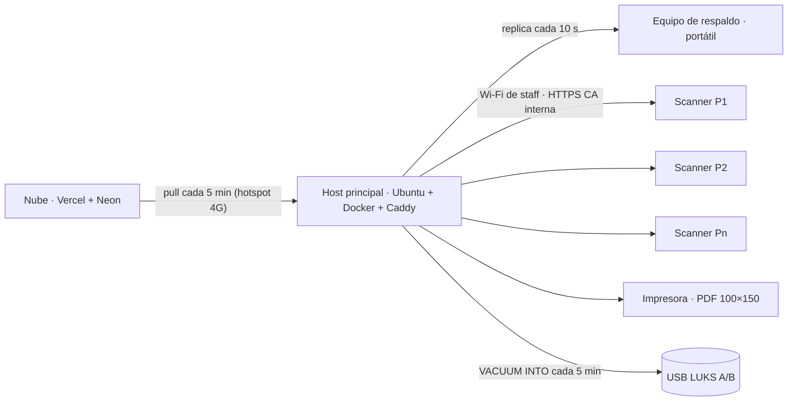

# 90 · Montaje del ecosistema: de cero a simulacro — Tatami Pass

> Guía única para el **técnico** que monta todo: portátil de desarrollo, nube, host en la sede, red del coliseo, scanners, impresión, prueba en casa, simulacro y día D. Cada paso trae el comando o la acción exacta y **cómo saber que salió bien**. Tiempos estimados por bloque. Depende de [00-DECISIONES](./00-DECISIONES.md); detalle de operación en [50](./50-OPERACION.md), de seguridad en [40](./40-SEGURIDAD-ISO27001.md), de pruebas en [80](./80-COMO-PROBAR.md) y [20](./20-RF-TEST.md). Las marcas `☐` son para imprimir y tachar.
>
> **Honestidad sobre lo verificado**: los comandos de los bloques 1, 7 y los `curl` contra el host están verificados en Linux con Node 22. Los pasos de Ubuntu/Docker/LUKS/chrony/mesh siguen la documentación oficial de cada herramienta y el runbook [50 §3](./50-OPERACION.md); pruébalos en el bloque 7 y 8 antes del día D, no el día D.

## Mapa y tiempos

| # | Bloque | Dónde | Tiempo | Cuándo |
|---|---|---|---|---|
| 1 | Entorno de desarrollo | tu portátil | 30 min | hoy |
| 2 | Nube (inscripción) | Vercel + Neon | 1 h | T−30 |
| 3 | Host: app de escritorio (Mac/Windows, 30 min) o Docker en mini PC Ubuntu (2–3 h) | sede (o en casa primero) | 0,5–3 h | T−14 |
| 4 | Red del coliseo | coliseo | 2 h + 1 h de medición | T−7 y T−1 |
| 5 | Scanners | 6 + 2 celulares | 15 min por dispositivo | T−7 |
| 6 | Impresión | mesa de acreditación | 1 h | T−7 |
| 7 | Prueba en casa (1 portátil + 2 celulares) | tu casa | 30 min | T−14 |
| 8 | Simulacro | coliseo | 3 h | T−7 |
| 9 | Día D | coliseo | H−2 a cierre | D |
| 10 | Problemas frecuentes | — | — | siempre |



---

## 1. Entorno de desarrollo en un portátil (30 min)

Requisitos: Node ≥ 20 (probado con 22), npm 10, git, 2 GB libres. Para `better-sqlite3`, si no hay binario para tu plataforma: `python3`, `make`, `g++`.

1. ☐ Clona e instala.
   ```bash
   git clone <repo> tatami-pass && cd tatami-pass
   npm install          # instala todos los workspaces y compila packages/core (hook "prepare")
   ```
   **Salió bien si**: termina sin `ERR!` y existe `packages/core/dist/index.js`.
2. ☐ Tests y build.
   ```bash
   npm test             # core (unitarios con cobertura) + host + scanner + registration
   npm run build        # todos los workspaces (core → host → host-admin → print → registration → scanner)
   ```
   **Salió bien si**: `npm test` termina con `Test Files … passed` en cada workspace y sin `failed`; `npm run build` deja `apps/host/dist`, `apps/host/public/admin/index.html`, `apps/scanner/dist` y `apps/registration/.next`.
3. ☐ Simulación de carga.
   ```bash
   npm run simulate
   ```
   **Salió bien si**: p95 de validación muy por debajo de 300 ms, `30/30 revocadas denegadas`, `100/100 anti-passback denegados` y la línea `… → CONSISTENTE`.
4. ☐ Host con datos de demo y panel.
   ```bash
   npm run seed         # 2.000 credenciales, 7 usuarios, 4 scanners de demo (PIN 123456)
   npm run dev:host     # http://localhost:8787 · panel en http://localhost:8787/admin
   ```
   **Salió bien si**: `curl -s localhost:8787/health | jq .ok` → `true`, y en `/admin` entras con `admin` / `admin123` y ves "Puertas en vivo".
5. ☐ Scanner en el navegador del portátil (misma máquina = `localhost` cuenta como contexto seguro, la cámara abre sin HTTPS).
   ```bash
   npm run dev:scanner  # http://localhost:5173
   ```
   En el panel › Dispositivos › **Enrolar un scanner** → copia el código → en el scanner pega el código, host `http://localhost:8787`, PIN de 6 dígitos.
   **Salió bien si**: el scanner muestra la zona y "Conectado"; en el panel el dispositivo aparece "conectado".
6. ☐ E2E (Playwright, Chromium).
   ```bash
   npx playwright install chromium          # una vez
   npm run e2e:smoke                        # subconjunto rápido (si tu versión aún no lo trae: E2E_SKIP_REGISTRATION=1 npm run e2e)
   npm run e2e                              # suite completa ≈ 2 min + builds
   ```
   **Salió bien si**: `N passed` y ningún `failed`; en fallo mira `e2e/test-results/` (captura, vídeo, trace).
7. ☐ Documentación navegable (opcional): `npm run docs:dev` → http://localhost:5173 o el puerto que indique.

---

## 2. Montar la nube (1 h) — resumen; el paso a paso está en [85](./85-DESPLIEGUE-NUBE.md)

1. ☐ **Neon**: crea el proyecto Postgres, copia `DATABASE_URL`. Corre las migraciones: `DATABASE_URL=… npm run migrate -w apps/registration` → imprime `migración aplicada: 001_init.sql · 002_credential_token.sql · admin inicial creado` ([85 §1](./85-DESPLIEGUE-NUBE.md)).
2. ☐ **Vercel Blob** para fotos y **Resend** para correos: tokens en variables de entorno ([85 §2–3](./85-DESPLIEGUE-NUBE.md)).
3. ☐ **Proyecto Vercel** con raíz `apps/registration`, variables: `DATABASE_URL`, `BLOB_READ_WRITE_TOKEN`, `RESEND_API_KEY`, `TP_CLOUD_KEY` (clave compartida con el host; `openssl rand -hex 32`), `CRON_SECRET`, `EVENT_CONFIG_PATH` si usas una config distinta ([85 §4](./85-DESPLIEGUE-NUBE.md)).
4. ☐ **Dominio** propio y HTTPS ([85 §5](./85-DESPLIEGUE-NUBE.md)).
5. ☐ **Clave de firma**: la nube necesita la **pública** del host para la credencial digital ([85 §7](./85-DESPLIEGUE-NUBE.md)); el host la imprime en `GET /system/health` → `key.publicKeyHex` (o en el panel › Sistema).
6. ☐ **Verificación de 5 minutos** ([85 §10](./85-DESPLIEGUE-NUBE.md)): formulario público carga, `GET /api/status` responde con cupos, una inscripción de prueba llega al panel `/panel`, se aprueba y `curl -H "x-tatami-key: $TP_CLOUD_KEY" https://<nube>/api/export | jq '.registrations | length'` devuelve ≥ 1.

**Salió bien si**: el paso 6 completo pasa y el checklist de seguridad de [85 §9](./85-DESPLIEGUE-NUBE.md) está en verde antes de abrir inscripciones.

---

## 3. Montar el host (2–3 h con Docker · 30 min con la app de escritorio)

Equipo: ver [50 §1.1](./50-OPERACION.md). Hay dos formas de tener el host corriendo; eligen lo mismo que el resto del sistema (mismas rutas, mismo panel, mismas copias, misma réplica):

| | **Opción A · App de escritorio "Tatami Pass Host"** (Mac / Windows) | **Opción B · Docker + Caddy** (mini PC Ubuntu) |
|---|---|---|
| Para quién | El Administrador o un técnico sin terminal; el host es el portátil de la mesa de acreditación | Técnico con Ubuntu; host dedicado sin pantalla, hardening de [40 §7](./40-SEGURIDAD-ISO27001.md) |
| Qué hay que hacer | Instalar la app, asistente de 4 pasos, exportar el certificado raíz | §3.1–3.4 de abajo |
| HTTPS en la LAN | Caddy incluido en la app (`tls internal`, puerto 8443), certificado raíz con un botón | Caddy en `docker-compose.yml` (puerto 443), `docker compose cp` del root |
| Copias a USB | Botón **Copia a USB ahora** o carpeta secundaria en Ajustes | `TP_BACKUPS_DIR_2` + USB LUKS (§3.3) |
| Respaldo | Asistente en modo "Equipo de respaldo" + **Promover a principal** en la ventana | `TP_ROLE=standby` (§3.4) |
| Arranque automático | "Arrancar al iniciar sesión" en Ajustes | `restart: unless-stopped` |
| Guía | [86-APP-ESCRITORIO](./86-APP-ESCRITORIO.md) (instalación, datos, migración desde Docker, checklist) | este capítulo |

**Opción A en 5 pasos**: 1) instala el `.dmg` / instalador `.exe` ([86 §2.1](./86-APP-ESCRITORIO.md); sin firma: clic derecho › Abrir / SmartScreen › Ejecutar de todas formas); 2) asistente: sede, modo Principal, passphrase del sobre, tu `event.config.json` (o demo para el simulacro), carpeta de la USB; 3) **Exportar certificado raíz** e instálalo en los celulares (§5); 4) enrola los scanners con el QR de la ventana; 5) en el segundo portátil, la misma app en modo **Equipo de respaldo** apuntando a `http://<ip-del-principal>:8787` con la misma passphrase y la clave de replicación de Ajustes. Ensaya la promoción (§3.4 paso 17) desde la ventana: **Promover a principal** → SI → PROMOVER. IP fija y reloj (§3.1 pasos 2–3) siguen siendo responsabilidad del sistema operativo.

**Opción B** (lo que sigue): Ubuntu 24.04 LTS **instalado con "Encrypt the new Ubuntu installation" (LUKS)**. Usuario `ops`. Todo lo que sigue se hace una vez en el principal y se repite (con diferencias marcadas) en el respaldo.

### 3.1 Base del sistema (30 min)

1. ☐ Hardening ([40 §7.1](./40-SEGURIDAD-ISO27001.md)): `ufw` con solo 22 (solo desde la LAN de staff), 80 y 443; SSH solo por llave; `unattended-upgrades`; sin suspensión al cerrar la tapa.
   ```bash
   sudo apt update && sudo apt install -y ufw chrony git curl jq
   sudo ufw default deny incoming && sudo ufw allow from 10.10.0.0/24 to any port 22 proto tcp && sudo ufw allow 80,443/tcp && sudo ufw enable
   sudo sed -i 's/^#\?HandleLidSwitch=.*/HandleLidSwitch=ignore/' /etc/systemd/logind.conf && sudo systemctl restart systemd-logind
   ```
   **Salió bien si**: `sudo ufw status` muestra las tres reglas y `Status: active`.
2. ☐ **chrony** como reloj de la LAN (el host es el NTP de los scanners; sin internet sirve su propio reloj).
   ```bash
   sudo tee -a /etc/chrony/chrony.conf > /dev/null <<'EOF'
   allow 10.10.0.0/24
   local stratum 10
   EOF
   sudo systemctl restart chrony && chronyc tracking
   ```
   **Salió bien si**: `chronyc tracking` muestra `Leap status : Normal`; si no hay internet, fija la hora a mano una vez (`sudo date -s "2026-11-20 07:00:00"`) y comprueba `timedatectl`.
3. ☐ **IP fija** en la LAN de staff (ver [50 §3](./50-OPERACION.md) paso 2): `10.10.0.2/24`, sin ruta por defecto en esa interfaz (la salida a internet, si la hay, va por el hotspot). `ip -4 addr` muestra `10.10.0.2`.
4. ☐ **Docker** ([50 §3](./50-OPERACION.md) paso 1). **Salió bien si**: `docker compose version` responde y `docker run --rm hello-world` imprime "Hello from Docker!".

### 3.2 Código, secretos y arranque (30 min)

5. ☐ Clona el repo en `/opt/tatami` (o copia el `.zip` desde USB si no hay internet) y entra en `apps/host`.
   ```bash
   sudo mkdir -p /opt/tatami && sudo chown ops:ops /opt/tatami
   git clone <repo> /opt/tatami && cd /opt/tatami/apps/host
   ```
6. ☐ **Variables** en `apps/host/.env` (lo lee `docker compose`). Genera las claves con `openssl rand -hex 32`. Guarda la passphrase en el sobre sellado del Administrador: sin ella no se puede firmar ni leer la PII.
   ```bash
   cat > .env <<'EOF'
   TP_KEY_PASSPHRASE=<passphrase larga, 20+ caracteres>
   TP_CLOUD_URL=https://<tu-nube>.vercel.app
   TP_CLOUD_KEY=<misma clave que TP_CLOUD_KEY en Vercel>
   TP_CLOUD_INTERVAL_MIN=5
   TP_ROLE=primary
   TP_REPLICA_KEY=<clave compartida con el respaldo>
   TP_RETENTION_DAYS=90
   EOF
   chmod 600 .env
   ```
7. ☐ **Nombre del host en el Caddyfile**: por defecto responde a `host.tatami.local` y `localhost`. Si usas IP directa, añade la IP al primer renglón del `Caddyfile` (`host.tatami.local, localhost, 10.10.0.2 {`). Sin esto Caddy devuelve 404 por nombre desconocido.
8. ☐ **Scanner servido por el mismo Caddy** (el host no sirve la PWA; Caddy sí puede). Compila la PWA en tu portátil (`npm run build -w apps/scanner`) y copia `apps/scanner/dist` al host; después crea un `docker-compose.override.yml` junto al `docker-compose.yml`:
   ```yaml
   services:
     caddy:
       volumes:
         - ../scanner/dist:/srv/scanner:ro
         - /media/usb-a:/backups2            # USB de copias (bloque 3.4)
     host:
       environment:
         TP_BACKUPS_DIR_2: /backups2
       volumes:
         - /media/usb-a:/backups2
   ```
   y añade al `Caddyfile` un segundo sitio:
   ```
   scanner.tatami.local, 10.10.0.2:8443 {
   	tls internal
   	root * /srv/scanner
   	file_server
   	try_files {path} /index.html
   }
   ```
   (Si prefieres un solo nombre, sirve la PWA bajo `/scanner` con `handle_path /scanner/*`. El QR de enrolamiento lleva la URL del host, no de la PWA, así que cualquiera de las dos vale.)
9. ☐ **Arranque**.
   ```bash
   docker compose up -d --build        # la primera vez compila core, print, host-admin y host (5–10 min)
   docker compose logs -f host         # espera "listening" y mode=primary; Ctrl+C
   curl -sk https://localhost/health | jq '{ok,mode,event,credentials,audit}'
   ```
   **Salió bien si**: `ok: true`, `mode: "primary"`, `event: "nac2026"`, `audit.ok: true`. En `https://10.10.0.2/admin` el navegador avisa del certificado (normal hasta instalar la CA): entra con el admin del seed o crea usuarios.
10. ☐ **Datos**: *o bien* seed de demo (`docker compose exec host node dist/seed.js` dentro del contenedor, que respeta `TP_DB_PATH=/data/tatami.db`; verificado en local con `npm run seed`), *o bien* datos reales: panel › Nube › **Traer ahora** con el hotspot conectado.
    **Salió bien si**: panel › Credenciales lista personas y `GET /sync/cloud/status` muestra `lastPullAt` reciente sin error.
11. ☐ **Usuarios reales** (panel › Usuarios): un `coord`, un `print`, un `super` por supervisor, un `audit`. Cambia la contraseña del `admin`. Anota todo en el sobre del Administrador.
12. ☐ **Exporta la CA de Caddy** para los teléfonos ([80 §11](./80-COMO-PROBAR.md)).
    ```bash
    docker compose cp caddy:/data/caddy/pki/authorities/local/root.crt ./root.crt
    ```
    **Salió bien si**: `openssl x509 -in root.crt -noout -subject` imprime `Caddy Local Authority`. Copia `root.crt` a una USB y al correo del comité.

### 3.3 Copias de seguridad a USB cifrada (20 min, dos USB)

13. ☐ Formatea cada USB con LUKS (**borra la USB**; identifícala con `lsblk`).
    ```bash
    sudo cryptsetup luksFormat /dev/sdX          # escribe YES y la passphrase de la USB
    sudo cryptsetup open /dev/sdX usba && sudo mkfs.ext4 /dev/mapper/usba
    sudo mkdir -p /media/usb-a && sudo mount /dev/mapper/usba /media/usb-a && sudo chown 1000:1000 /media/usb-a
    ```
    Repite con `usbb` / `/media/usb-b`. Para rotar: `umount` + `cryptsetup close`, conectar la otra, `open` + `mount` en **la misma ruta** `/media/usb-a` (el host solo conoce `/backups2`).
14. ☐ Reinicia el host (`docker compose up -d`) para que tome `TP_BACKUPS_DIR_2` y haz una copia: panel › Sistema › **Hacer copia ahora**.
    **Salió bien si**: el mensaje dice "también en el segundo destino" y `ls /media/usb-a` muestra un `.db` nuevo. **Verificar** en el panel abre la copia y los conteos coinciden.

### 3.4 Equipo de respaldo (standby) en un segundo portátil (30 min)

15. ☐ Repite 3.1 y 3.2 pasos 5–7 con IP `10.10.0.3` y este `.env`: misma `TP_KEY_PASSPHRASE`, `TP_ROLE=standby`, `TP_PRIMARY_URL=https://10.10.0.2`, mismo `TP_REPLICA_KEY`. Copia la **misma clave de firma** (volumen `tatami-keys` del principal: `docker compose cp host:/keys/signing.enc.json ./signing.enc.json` en el principal y `docker compose cp ./signing.enc.json host:/keys/` en el respaldo) y la **misma CA** de Caddy (volumen `caddy-data`), para que los scanners confíen en ambos sin reinstalar nada.
16. ☐ Arranca y comprueba la réplica.
    ```bash
    docker compose up -d --build
    curl -sk https://localhost/health | jq '{role, lagSeconds, standby: .standby.message}'
    ```
    **Salió bien si**: `role: "standby"` y `lagSeconds` ≤ 10 tras un minuto; `https://10.10.0.3/admin` abre en modo consulta (cualquier cambio responde 409 "Este equipo es el de respaldo").
17. ☐ **Ensayo de promoción** (hazlo ahora, no el día D): apaga el principal (`docker compose stop` en el principal), en el respaldo panel › Sistema › **Convertir en principal** (escribe PROMOVER) o `docker compose exec host node dist/promote.js`.
    **Salió bien si**: `/health` del respaldo pasa a `mode: "primary"` y un scanner apuntado a `https://10.10.0.3` enrola y escanea. Después **vuelve atrás para el ensayo**: restaura el principal y vuelve a dejar el respaldo como standby (borra el volumen de datos del respaldo o `TP_ROLE=standby` + `docker compose up -d` tras `docker compose down -v`). En producción, **nunca** reenciendas el principal viejo como principal.

---

## 4. Red del coliseo (2 h montaje + 1 h medición)

Plano y lista de equipos en [50 §1.2 y §2](./50-OPERACION.md). Resumen operativo:

1. ☐ **Router / mesh principal** en la sala técnica junto al host (cable Ethernet host ↔ router, nunca Wi-Fi para el host). Configura:
   - SSID de staff **oculto**, WPA2/WPA3, contraseña larga; aislamiento de clientes **desactivado** (los scanners hablan con el host); DHCP `10.10.0.100–10.10.0.200`; el host en `10.10.0.2` fuera del rango DHCP.
   - 2,4 GHz y 5 GHz con el mismo SSID; los scanners modernos usan 5 GHz cerca del nodo y bajan a 2,4 GHz lejos.
   - Sin salida a internet en esta red (o bloqueada): el host usa el hotspot 4G aparte.
   - DNS local: si el router permite, `host.tatami.local → 10.10.0.2`; si no, los scanners usan la IP.
   **Salió bien si**: un portátil conectado al SSID recibe IP `10.10.0.1xx` y `curl -sk https://10.10.0.2/health` responde.
2. ☐ **Nodos mesh / repetidores**: nodo 2 en la mesa de acreditación, nodo 3 en altura sobre la zona de competencia, uno más por puerta exterior o detrás de gradería de concreto. Mesh real (Deco/UniFi) se configura solo; con repetidores clásicos usa el **mismo SSID** y fija canales **1 / 6 / 11** en 2,4 GHz, uno por nodo, y canales no solapados en 5 GHz (36 / 44 / 52).
3. ☐ **Mini-UPS** en cada nodo lejos del UPS principal; etiqueta cada nodo ("MESH-2 ACREDITACIÓN").
4. ☐ **Medición de cobertura con un celular** ([50 §2.2](./50-OPERACION.md)): instala WiFiman (Ubiquiti) o WiFi Analyzer, párate exactamente donde estará cada portero y anota el RSSI en la tabla del [acta de simulacro](./_plantillas/acta-simulacro.md) §3.
   **Salió bien si**: todas las puertas ≥ −70 dBm en vacío (el día D la gente resta ~5 dBm). Si una queda entre −70 y −75, mueve o añade un nodo; si < −75, esa puerta opera en modo local permanente (funciona, pero sin alertas de duplicado en tiempo real).
5. ☐ **Plan de canales escrito** y pegado en la sala técnica: nodo, ubicación, canal 2,4, canal 5, mini-UPS sí/no.

---

## 5. Scanners (15 min por dispositivo)

Requisitos: Android 11+ con Chrome 100+ o iPhone con iOS 16+; pantalla ≥ 6"; funda con agarre; **etiqueta** con el nombre de la puerta ("P1-NORTE"); power bank 20.000 mAh con cable.

1. ☐ **Hora automática** activada (Ajustes › Fecha y hora); brillo al 70 %; bloqueo de pantalla con PIN del comité; notificaciones silenciadas (modo No molestar).
2. ☐ **Conecta al SSID de staff** (oculto: escribe el nombre a mano).
3. ☐ **Instala la CA de Caddy** (`root.crt` del bloque 3, paso 12):
   - **Android (Chrome)**: copia `root.crt` al teléfono → Ajustes › Seguridad › Cifrado y credenciales › Instalar certificado › **Certificado de CA** → acepta el aviso. Abre `https://10.10.0.2/health` en Chrome: candado cerrado y `"ok":true`.
   - **iOS (Safari)**: envía `root.crt` por AirDrop o correo → Ajustes › Perfil descargado › Instalar → **luego** Ajustes › General › Información › Configuración de confianza de certificados → activa la confianza total. Sin ese segundo paso la cámara no abre.
   **Salió bien si**: `https://10.10.0.2/health` abre **sin** aviso de seguridad.
4. ☐ **Instala la PWA**: abre la URL del scanner (`https://scanner.tatami.local` o `https://10.10.0.2:8443`, según el bloque 3 paso 8). Android/Chrome → menú ⋮ › **Instalar aplicación**; iOS/Safari → Compartir › **Añadir a pantalla de inicio**. Ábrela **desde el icono**.
   **Salió bien si**: corre a pantalla completa (sin barra del navegador) y, con el Wi-Fi apagado, vuelve a abrir y muestra la pantalla de enrolamiento o "Sin conexión · modo local".
5. ☐ **Enrola**: en el panel (portátil del supervisor) › Dispositivos › **Enrolar un scanner** → nombre "P1 Norte", zona, rol Control (o Supervisor para el teléfono del supervisor) → el QR aparece con cuenta regresiva de 10 min. En el scanner: **Escanear código de enrolamiento** (o pegar el código y la dirección del host) → PIN de 6 dígitos (lo elige el portero; el supervisor lo anota en el sobre).
   **Salió bien si**: el scanner muestra la zona, "Conectado" y "Credenciales: N" igual al conteo del panel; en el panel › Dispositivos aparece "conectado", pendientes 0.
6. ☐ **Prueba de cámara**: escanea una credencial impresa de staff → verde "Adelante, <nombre>" con foto o iniciales en < 300 ms (contador de ms en la esquina). Prueba ⟳ (cambio de cámara) y 🔦 (linterna; en iOS no existe desde la web). Escanea la misma dos veces en zona con anti-passback → rojo "ya entró a … a las H:MM".
7. ☐ **Modo avión 2 min** con 3 escaneos → "Pendientes: 3"; quita modo avión → pendientes a 0 en ≤ 15 s.
8. ☐ **Power bank** conectado y cargado; cable corto y fijado con velcro a la funda. Consumo esperado ≤ 10 %/h.
9. ☐ Registra el dispositivo en la tabla del [checklist día D](./_plantillas/checklist-dia-d.md) (modelo, SO, etiqueta, PIN en sobre).

Repite para los 2 de reserva (enrolados con zona de la puerta principal; se cambia la zona desde el panel cuando haga falta).

---

## 6. Impresión (1 h)

Equipo en [50 §1.1 y §1.4](./50-OPERACION.md): láser color A4 + papel 200 g o PVC láser, guillotina, lanyards por color, hologramas.

1. ☐ **Muestra local** en tu portátil: `npm run print:sample` → `apps/print/out/sample-credentials.pdf`. Imprime una hoja: cada credencial mide **100 × 150 mm** (regla en mano), colores por rol, QR de 40 mm nítido, ID corto legible a 1 m.
2. ☐ **Lee el QR impreso** con un scanner enrolado → verde. Si no lee: más contraste (tóner), sin brillo (papel mate), impresión al 100 % sin "ajustar a página".
3. ☐ **Lote de prueba desde el panel** (operador `print`): Impresión › crear lote por rol (p. ej. STAFF) › **Vista previa** › **Descargar PDF** › imprime 20 › **Marcar como impreso**. Corta, pliega en lanyard, pega holograma sobre el ID.
   **Salió bien si**: las 20 leen en verde en un scanner y en Credenciales aparecen como "Impresa"; `Marcar entregado` las pasa a "Entregada".
4. ☐ **Tiempo de lote grande**: crea un lote de 500 → el PDF llega en < 60 s (`PRINT_BATCH_PDF.ms` en Auditoría).
5. ☐ **Insumos**: tóner de repuesto, 2.500 hojas/tarjetas, lanyards por color con 10 % extra, impresora de respaldo probada con el mismo PDF.

---

## 7. Prueba en casa con 1 portátil + 2 celulares (guion de 30 min)

Objetivo: ver todo el flujo sin coliseo. Portátil con el repo instalado (bloque 1) y dos celulares en el **mismo Wi-Fi** del portátil. Dos caminos para el HTTPS de la cámara:

- **Camino A (recomendado, igual que la sede)**: Docker + Caddy en el portátil (bloque 3.2 pasos 6–12 con la IP de tu portátil en el `Caddyfile`), CA instalada en los dos celulares.
- **Camino B (rápido, solo Android/Chrome, solo para esta prueba)**: `npm run seed && npm run dev:host` (http en `:8787`) y `npm run dev:scanner` (`vite --host`, http en `:5173`). En cada celular, `chrome://flags/#unsafely-treat-insecure-origin-as-secure` → añade `http://<ip-del-portátil>:5173` y `http://<ip-del-portátil>:8787` → Relaunch. La cámara abrirá por http. **No** uses esto en la sede.

| Min | Paso | Salió bien si |
|---|---|---|
| 0–3 | Portátil: host arriba (`/health` ok), panel abierto como `admin`. Imprime (o muestra en pantalla del portátil) 3 credenciales: `Credenciales` › toca una › **Ver QR / token**. | 3 QR a la vista: una COMP, una GEN, una STAFF. |
| 3–8 | Celular 1: instala CA (camino A) o flag (camino B), abre la PWA, instálala, enrola como "Casa-T" zona **T** rol Control. | "Conectado", credenciales = 2000. |
| 8–11 | Celular 2: igual, enrola como "Casa-G" zona **G** rol Supervisor. | Ambos "conectado" en panel › Dispositivos. |
| 11–13 | Celular 1 escanea la COMP → verde. La vuelve a escanear → rojo anti-passback con hora. | Panel › Puertas en vivo: 1 ingreso en T, 1 rechazo. |
| 13–15 | Celular 2 escanea la **misma** COMP (zona G) en < 2 min → ámbar "posible duplicado". | Panel › Alertas: 1 abierta `DUPLICATE`; resuélvela con nota. |
| 15–18 | Panel: **Anular** la GEN (motivo "prueba"). Celular 2 escanea la GEN. | Rojo "credencial anulada" en ≤ 15 s tras anular. |
| 18–22 | Celular 1 en **modo avión**: escanea STAFF (verde), GEN (rojo), COMP en modo Salida (PIN del supervisor desde celular 2 o usuario `super`). | "Pendientes: 3". Quita modo avión → 0 en ≤ 15 s; panel muestra los 3 eventos. |
| 22–25 | Celular 1: **Ingreso manual** con el ID corto de la STAFF, motivo "QR no se lee". | Verde; Panel › Alertas › ingreso manual con motivo. |
| 25–28 | Celular 2: **Terminar turno** → resumen (entradas/salidas/negados/manuales). | Totales coinciden con lo hecho. |
| 28–30 | Panel › Sistema › **Hacer copia ahora**; Auditoría › **Verificar cadena**. | "Copia de seguridad creada"; "Registro íntegro hasta el número N". |

Anota tiempos y rarezas en un [reporte de defecto](./_plantillas/reporte-defecto.md) si algo no cuadra.

---

## 8. Simulacro a 7 días (3 h)

Obligatorio ([00 §10](./00-DECISIONES.md)). Guion minuto a minuto, participantes, material y métricas en [20 §7](./20-RF-TEST.md); evidencia en el [acta de simulacro](./_plantillas/acta-simulacro.md).

Antes de empezar (T−1 h):

- ☐ Bloques 3, 4, 5 y 6 completos en la sede real (no en casa).
- ☐ Versión etiquetada (`git tag`, ver `scripts/agent/release.ts`) anotada en el acta.
- ☐ ≥ 50 credenciales impresas de prueba + 5 fotocopias para la prueba de fraude; sobres de modo degradado por puerta.
- ☐ Respaldo replicando; USB A y B montadas; cobertura medida con la gradería vacía.

Ejecuta el guion de [20 §7.3](./20-RF-TEST.md) tal cual (apertura de 200 personas, QR fotocopiado, corte de red 10 min, caída del host y promoción, restauración desde USB, lote de 500, cierre) y rellena el acta. **Go** solo con los 16 ítems de [20 §7.5](./20-RF-TEST.md) en verde (o ámbar con plan antes de D−2). Cada P1 abre un `DEF-nnn` y se re-verifica con el mismo TC.

---

## 9. Día D — checklist

Imprime el [checklist del día D](./_plantillas/checklist-dia-d.md) (uno por día). Resumen de lo que no se negocia:

- ☐ H−2:00 `/health` del principal `ok` y `audit.ok`; respaldo con `lagSeconds` ≤ 10; copia manual en los dos destinos; hotspot solo al host; **Traer ahora** desde la nube.
- ☐ H−1:30 Inscripciones pendientes de imprimir = 0 antes de abrir la mesa de acreditación.
- ☐ H−1:00 Cada puerta: portero con PIN, zona correcta en pantalla, "Conectado", power bank, escaneo de prueba verde, sobre de modo degradado.
- ☐ Cada 2 h rotación USB A↔B; cada 3 h cambio de turno con **Terminar turno**.
- ☐ Cierre: salidas registradas, pendientes 0, copia verificada, cadena de auditoría íntegra, reporte de cierre descargado, host **encendido** toda la noche.
- ☐ Regla de oro: **la puerta nunca se detiene** por red, host o nube. Modo local → planilla → captura después.

---

## 10. Problemas frecuentes

| Síntoma | Causa probable | Qué hacer |
|---|---|---|
| El scanner no abre la cámara | Sin HTTPS de confianza (CA no instalada; en iOS falta "confianza total") | Repite bloque 5 paso 3. Comprueba `https://<host>/health` sin aviso. |
| "No pude conectar con el computador central" al enrolar | IP equivocada, `Caddyfile` sin ese nombre/IP, firewall | `curl -sk https://<ip>/health` desde un portátil en el mismo SSID. Añade la IP al `Caddyfile` y `docker compose restart caddy`. `sudo ufw status`. |
| Código de enrolamiento "no es válido o ya caducó" | Pasaron 10 min o ya se usó | Genera otro en el panel › Dispositivos. |
| Pendientes no bajan de N | Scanner sin señal o host caído | RSSI en la puerta; `/health` del host; si el host no vuelve en 2 min, promueve el respaldo ([3.4 paso 17](#34-equipo-de-respaldo-standby-en-un-segundo-portátil-30-min)) y cambia la dirección del host en los scanners (menú ⋯ › Cambiar dirección) o el DNS. |
| Rojo "ya entró a Tatamis" a alguien que sí salió | Salió sin escanear | Supervisor: **Autorizar excepción** con PIN (motivo "Salió sin escanear"); recordar escanear salidas. |
| Ámbar "posible duplicado" | QR fotocopiado o persona que corrió entre puertas | Comparar foto/documento; si es fraude, panel › **Anular** y retener la credencial; resolver la alerta con nota. |
| Franja ámbar de reloj en el scanner | Hora del celular desviada > 5 min | Ajustes › hora automática; el host es el NTP de la LAN (chrony). |
| Panel responde 409 "Este equipo es el de respaldo" | Estás en `10.10.0.3` | Usa el principal; o promueve si el principal cayó. |
| `TP_KEY_PASSPHRASE es obligatoria en producción` al arrancar | `.env` sin passphrase | Rellena `.env` (sobre del Administrador) y `docker compose up -d`. |
| Copia "también en el segundo destino" falla | USB no montada en `/media/usb-a` | `lsblk`, `cryptsetup open`, `mount`; la copia local sigue funcionando. |
| Nube: "sin conexión a la nube, se reintenta en N min" | Hotspot caído o clave distinta | `curl -H "x-tatami-key: …" https://<nube>/api/status`; comparar `TP_CLOUD_KEY` en ambos lados. Sin nube, el evento sigue (emisión en sitio). |
| QR impreso no lee | Bajo contraste, brillo del papel, escala | Reimprime al 100 % en papel mate; prueba con linterna apagada. |
| `npm install` falla en `better-sqlite3` | Sin binario para la plataforma | Instala `python3 make g++` y repite; o usa Node 20/22 LTS. |
| iOS: PWA no se instala sola | Limitación de plataforma | Compartir › Añadir a pantalla de inicio (manual). |
| Dos hosts "principales" tras una promoción | Reencendieron el viejo como primary | Apaga uno ya. Arranca el viejo como `TP_ROLE=standby` apuntando al nuevo; revisa duplicados en Auditoría. |
