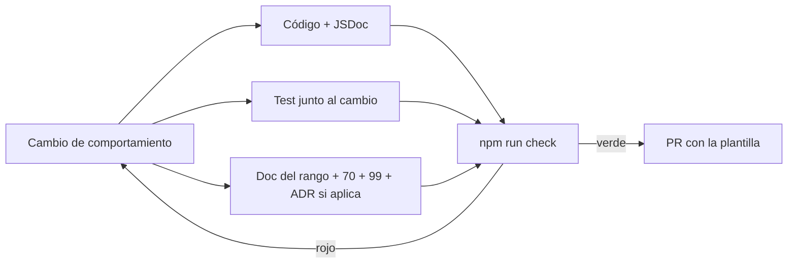

# Documentación de Tatami Pass

> Mapa de la documentación: qué leer según quién eres, cómo está numerada, cómo se escribe y cómo se mantiene. El sitio navegable (búsqueda, Mermaid, sidebar por público) se levanta con `npm run docs:dev` y se publica con `npm run docs:build` (`docs-site/`).

## Si eres…

| Si eres | Lee primero | Después |
|---|---|---|
| **Directivo / federación** que decide si esto va | [10-PRD](./10-PRD.md) §1–3 (resumen, problema, métricas) | [00-DECISIONES](./00-DECISIONES.md) §2 (funciona aunque no haya nada), [40-SEGURIDAD](./40-SEGURIDAD-ISO27001.md) §1 y §6 (ISO y Ley 1581) |
| **Administrador del evento** | [60-MANUALES-POR-ROL](./60-MANUALES-POR-ROL.md) §1 | [32-CONFIG-EVENTO](./32-CONFIG-EVENTO.md), [33-DISENO-CREDENCIAL](./33-DISENO-CREDENCIAL.md), [50-OPERACION](./50-OPERACION.md) §5 y §9, [85-DESPLIEGUE-NUBE](./85-DESPLIEGUE-NUBE.md) |
| **Coordinador de acreditación** | [60-MANUALES-POR-ROL](./60-MANUALES-POR-ROL.md) §2 | [50-OPERACION](./50-OPERACION.md) §8–9, plantillas de [acta de simulacro](./_plantillas/acta-simulacro.md) y [checklist día D](./_plantillas/checklist-dia-d.md) |
| **Control de entradas / Supervisor** (porteros) | [60-MANUALES-POR-ROL](./60-MANUALES-POR-ROL.md) §5–6 | [70-UX-WRITING](./70-UX-WRITING.md) §4 (qué significa cada pantalla) |
| **Técnico que monta el host, la red y los scanners** | [90-MONTAJE-ECOSISTEMA](./90-MONTAJE-ECOSISTEMA.md) (de cero a simulacro) | [50-OPERACION](./50-OPERACION.md) §1–3 y §7, [40-SEGURIDAD](./40-SEGURIDAD-ISO27001.md) §7, [85-DESPLIEGUE-NUBE](./85-DESPLIEGUE-NUBE.md) |
| **Desarrollador** que va a tocar el código | [`CLAUDE.md`](../CLAUDE.md) de la raíz (mapa, comandos, invariantes) | [30-ARQUITECTURA](./30-ARQUITECTURA.md), [31-API-REFERENCIA](./31-API-REFERENCIA.md), [95-ADR](./95-ADR/), [80-COMO-PROBAR](./80-COMO-PROBAR.md) |
| **QA / quien prueba** | [80-COMO-PROBAR](./80-COMO-PROBAR.md) | [20-RF-TEST](./20-RF-TEST.md) (matriz RF ↔ TC, simulacro D−7, criterios de release) |
| **Auditor** (seguridad, datos personales) | [40-SEGURIDAD-ISO27001](./40-SEGURIDAD-ISO27001.md) | [60-MANUALES-POR-ROL](./60-MANUALES-POR-ROL.md) §7, [acta de purga](./_plantillas/acta-purga-datos.md), [99-CHANGELOG](./99-CHANGELOG.md) |
| **Agente de IA** (Claude Code, Cursor) | [`CLAUDE.md`](../CLAUDE.md) + [36-AGENTES](./36-AGENTES.md) | Skills en `.claude/skills/`, subagentes en `.claude/agents/` |

## Convención de numeración

Los números dicen **de qué trata** y **en qué orden se lee**. No se renumeran: otros documentos, el código y los tests los citan por nombre.

| Rango | Tema | Documentos |
|---|---|---|
| **00** | Decisiones (el contrato: todo lo demás debe ser coherente con esto) | [00-DECISIONES](./00-DECISIONES.md) |
| **10** | Producto | [10-PRD](./10-PRD.md) |
| **20** | Pruebas (plan, matriz RF ↔ TC, simulacro) | [20-RF-TEST](./20-RF-TEST.md) |
| **30–39** | Arquitectura y referencia técnica | [30-ARQUITECTURA](./30-ARQUITECTURA.md), [31-API-REFERENCIA](./31-API-REFERENCIA.md) (generado), [32-CONFIG-EVENTO](./32-CONFIG-EVENTO.md) (generado), [33-DISENO-CREDENCIAL](./33-DISENO-CREDENCIAL.md), [34-VOZ-RADIO](./34-VOZ-RADIO.md), [36-AGENTES](./36-AGENTES.md) |
| **40** | Seguridad y datos personales | [40-SEGURIDAD-ISO27001](./40-SEGURIDAD-ISO27001.md) |
| **50** | Operación (runbook del evento) | [50-OPERACION](./50-OPERACION.md) |
| **60** | Manuales por rol | [60-MANUALES-POR-ROL](./60-MANUALES-POR-ROL.md) |
| **70** | UX writing (voz, catálogo de mensajes) | [70-UX-WRITING](./70-UX-WRITING.md) |
| **80** | Cómo probar (comandos verificados) | [80-COMO-PROBAR](./80-COMO-PROBAR.md) |
| **85** | Despliegue de la nube | [85-DESPLIEGUE-NUBE](./85-DESPLIEGUE-NUBE.md) |
| **86** | App de escritorio del host (Mac/Windows): instalar, asistente, datos, firmar, checklist | [86-APP-ESCRITORIO](./86-APP-ESCRITORIO.md) |
| **90** | Montaje del ecosistema (de cero a simulacro) | [90-MONTAJE-ECOSISTEMA](./90-MONTAJE-ECOSISTEMA.md) |
| **95** | ADRs (una decisión por archivo) | [95-ADR/](./95-ADR/) · plantilla [0000](./95-ADR/0000-plantilla.md) |
| **99** | Changelog | [99-CHANGELOG](./99-CHANGELOG.md) |
| `_plantillas/` | Plantillas para copiar (runbook de incidente, actas, reporte de defecto, checklist día D) | [_plantillas/](./_plantillas/) |

Un documento nuevo toma el número libre de su rango (p. ej. `33-…` para otra referencia técnica, `51-…` para un runbook específico). Si no cabe en ningún rango, primero se discute en un ADR.

## Reglas de estilo

**Prosa**

- Español neutro, tuteo, frases cortas. Nombres técnicos (`event.config.json`, `TP_ROLE`, `VACUUM INTO`) se escriben en código y no se traducen.
- Cada documento empieza con `# NN · Título — Tatami Pass` y una cita (`>`) de una o dos líneas que dice para quién es y de qué depende.
- Secciones numeradas (`## 1.`, `### 1.1`) para poder citarlas desde otros documentos ("ver 50 §7").
- Lo que el lector tiene que **hacer** va como lista numerada con el comando exacto o la acción exacta, y después "cómo saber que salió bien".
- Nada de "debería funcionar": si no se verificó, se dice que no se verificó (ver [80](./80-COMO-PROBAR.md) §9 como ejemplo de honestidad).

**Tablas**

- Para comparar opciones, mapear (RF ↔ TC, control ISO ↔ evidencia), listar campos o inventarios. Máximo 6 columnas; si no cabe, divide.
- Primera columna = la clave por la que alguien buscaría (código, rol, ruta, campo).

**Diagramas (Mermaid)**

- Se escriben en bloques ```` ```mermaid ```` dentro del Markdown (el sitio los renderiza; GitHub también). `flowchart` para topologías y flujos, `sequenceDiagram` para protocolos (sync, enrolamiento), `stateDiagram-v2` para estados de credencial.
- Etiquetas en español, cortas, sin jerga. Un diagrama explica **un** mecanismo; si necesita leyenda de más de 3 líneas, divide.

**UX writing en la documentación**

- Los textos que ve el usuario (pantallas, correos, impresos) se citan **tal cual** aparecen en el producto y viven en [70-UX-WRITING](./70-UX-WRITING.md). Si cambias un texto en el código, cambia el catálogo en el mismo PR.
- Usa el glosario humano ("copia de seguridad", no "backup"; "equipo de respaldo", no "standby") en manuales y runbooks; el término técnico puede ir entre paréntesis la primera vez.

**Generados**

- [31-API-REFERENCIA](./31-API-REFERENCIA.md) y [32-CONFIG-EVENTO](./32-CONFIG-EVENTO.md) los escribe `npm run docs:gen` a partir del código. No se editan a mano: se cambia el JSDoc o el tipo y se vuelve a generar.

## Proceso: código + test + doc en el mismo PR

Todo cambio de comportamiento toca **tres cosas a la vez**, y el PR no se aprueba si falta alguna:

1. **Código** (y JSDoc en rutas/tipos nuevos).
2. **Test** junto al cambio: unitario en `packages/core/test`, integración en `apps/host/test`, spec e2e en `e2e/` si cambia un flujo de usuario (nombrada por su TC de [20](./20-RF-TEST.md)).
3. **Doc**: el documento del rango que corresponde, el catálogo de [70](./70-UX-WRITING.md) si cambió un texto visible, [99-CHANGELOG](./99-CHANGELOG.md) bajo `[Sin publicar]`, y un ADR en [95](./95-ADR/) si la decisión tiene alternativas que alguien podría volver a abrir.

La lista de verificación está en [`.github/PULL_REQUEST_TEMPLATE.md`](../.github/PULL_REQUEST_TEMPLATE.md) y la corre `scripts/agent/check-all.sh` (`npm run check`): tests, build, typecheck, `docs:gen` sin diff y enlaces entre documentos sin romper.


